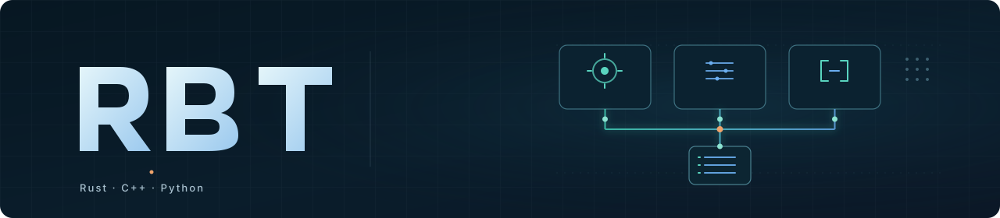
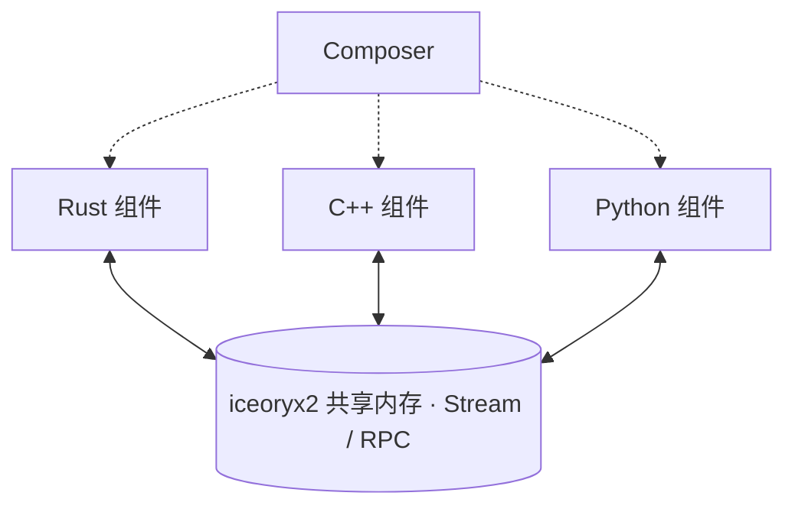

<p align="center">
  <strong>面向机器人的多语言零拷贝运行时</strong>
</p>

<p align="center">
  <a href="#快速上手">快速上手</a> ·
  <a href="docs/README.md">文档</a> ·
  <a href="examples/README.md">示例</a> ·
  <a href="#rbt-and-ros-2-transport-measurements">性能实测</a>
</p>

RBT 为 Linux 同机多进程机器人应用提供共享内存通信、组件编排和开发工具，支持 **Rust、C++20 与 Python / NumPy**。
数据面基于 [iceoryx2](https://github.com/eclipse-iceoryx/iceoryx2)，在此之上统一消息契约、生命周期、时间与坐标变换。

应用可以直接使用 SDK 连接进程，也可以通过 Composer 声明组件依赖、绑定能力并管理生命周期。

<a id="why-use-rbt-on-top-of-iceoryx2"></a>

## 核心能力

| 能力 | 提供什么 |
|---|---|
| **零拷贝数据流** | 图像、点云使用固定头部与连续可变长载荷，通过共享内存 loan / borrow 传递 |
| **统一消息契约** | 同一份 IDL 驱动多语言绑定，端点打开时校验 ABI |
| **组件与生命周期** | 按能力声明依赖，管理激活、取消与任务回收 |
| **时间与坐标变换** | 带时钟身份的时间戳、显式时钟映射，以及按采集时间查询的本地 TF 历史 |
| **运行时诊断** | 查看应用图、依赖状态和流压力，用 `rbt why` 定位组件阻塞原因 |
| **录制与回放** | 使用 MCAP 录制、回放 Image、PointCloud 和 ControlCommand |

## 运行方式

Composer 管理能力绑定与组件生命周期，组件进程通过共享内存直接交换数据。



## 快速上手

以下命令从源码构建 SDK 与命令行工具，并运行一个 Rust 发布 / 订阅应用。环境：**Linux x86_64、Rust 1.89+、Git**。

```bash
git clone https://github.com/sunwen-me/rbt.git
cd rbt
./scripts/bootstrap_iceoryx2_rbt.sh --source-only
cargo build --locked -p rbt-cli -p rbt-idl -p composer

export PATH="$PWD/target/debug:$PATH"
export RBT_RUST_SDK="$PWD"
rbt doctor
```

在源码目录之外创建项目：

```bash
mkdir -p ../rbt-work
cd ../rbt-work
rbt new hello-robot
cd hello-robot
rbt check
rbt run
```

组件进入 `ACTIVE` 后，终端会持续输出 `HELLO sequence=...`。按 Ctrl-C 停止应用。
在另一个终端进入项目目录，可以查看运行状态：

```bash
rbt ps
rbt graph
rbt why hello-sink
```

继续阅读[快速入门](docs/quickstart.md)，添加消息、创建组件并替换提供者；多语言 SDK 的构建与安装见[分发指南](docs/distribution.md)。

<a id="rbt-and-ros-2-transport-measurements"></a>

## 跨进程通信实测

RBT SDK 0.8.0 与 ROS 2 Lyrical / Fast DDS 3.6.2，在 Intel Core Ultra 5 125H、Linux x86_64 上运行独立的发布和订阅进程。
两侧使用相同的合成定长消息、填充与校验方式，队列深度为 1；每组预热 3 秒、测量 15 秒，重复 3 次。

下表为三次试验的中位数：**两进程 CPU 合计 / PSS 内存合计（MiB）**。CPU 100% 对应一个逻辑核心。

| 工作负载 | RBT 原生 loan | ROS 2 SHM（拷贝） | ROS 2 loan + Data Sharing |
|---|---:|---:|---:|
| IMU 尺寸 · 256 B · 200 Hz | 3.00% / **7.01** | 1.60% / 35.28 | 1.40% / 35.27 |
| 点云尺寸 · 1.60 MB · 10 Hz | 0.27% / **8.44** | 1.20% / 96.46 | 0.60% / 39.88 |
| 原始视频尺寸 · 1080p RGB8 · 30 Hz | 2.73% / **12.94** | 9.80% / 286.16 | 2.73% / 53.21 |

27 次试验均达到目标速率，投递率为 100%。这组配置下，RBT 的 PSS 在三个场景中均更低；CPU 表现随负载变化。

<details>
<summary>查看 CPU 与内存图表</summary>

柱形为中位数，圆点为三次试验，误差线为最小值至最大值。


</details>

[完整报告与原始数据](benchmarks/ros2_transport/results/2026-10-29/README.md) · [复现实验](benchmarks/ros2_transport/README.md)

## 文档

| 从这里开始 | 深入使用 |
|---|---|
| [快速入门](docs/quickstart.md) | [组件编写](docs/component-authoring.md) · [架构](docs/architecture.md) |
| [Rust SDK](docs/rust-sdk.md) · [C++ SDK](docs/cpp-sdk.md) · [Python SDK](docs/python.md) | [IDL](docs/idl.md) · [消息 ABI](docs/abi.md) · [RPC](docs/rpc.md) |
| [命令行工具](docs/cli.md) · [调试](docs/debugging.md) | [时间](docs/time.md) · [TF](docs/tf.md) · [MCAP](docs/mcap.md) |
| [示例项目](examples/README.md) | [构建与开发](docs/development.md) · [SDK 分发](docs/distribution.md) |

完整索引见[文档中心](docs/README.md)。欢迎通过 [Issues](https://github.com/sunwen-me/rbt/issues) 反馈问题，通过 [Pull Requests](https://github.com/sunwen-me/rbt/pulls) 贡献代码与文档。

## 许可证

RBT 采用 [MIT](LICENSE-MIT) 或 [Apache-2.0](LICENSE-APACHE) 双许可证，任选其一。
