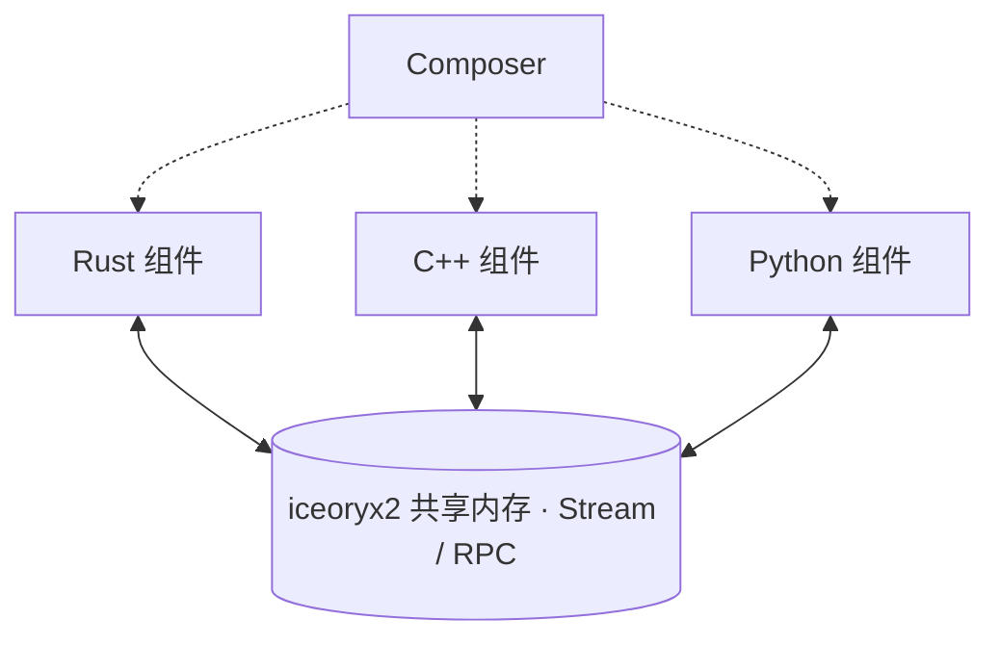
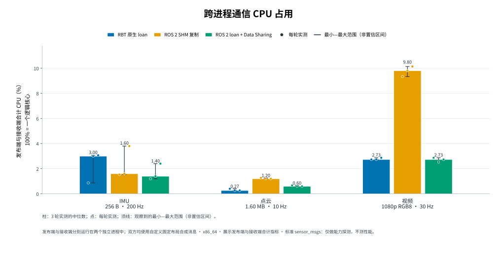
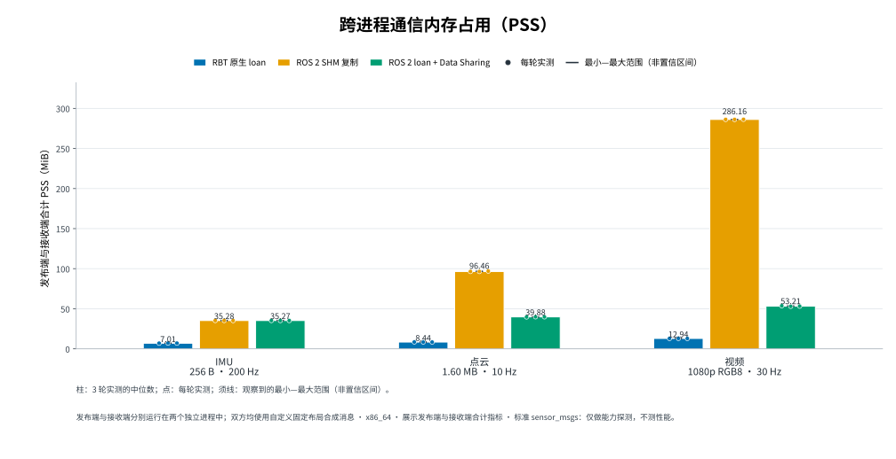
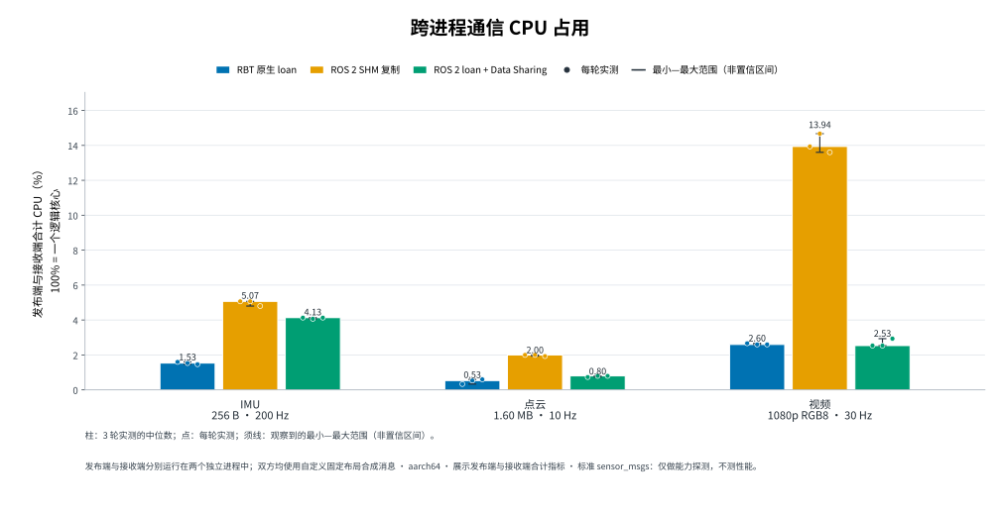
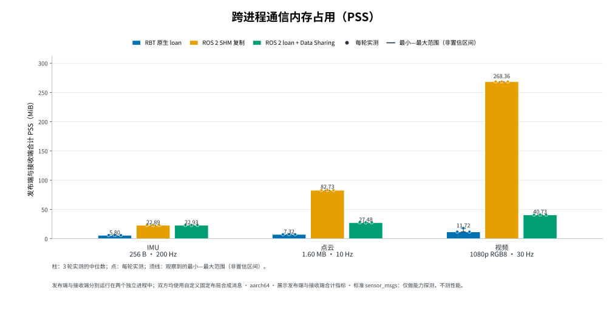
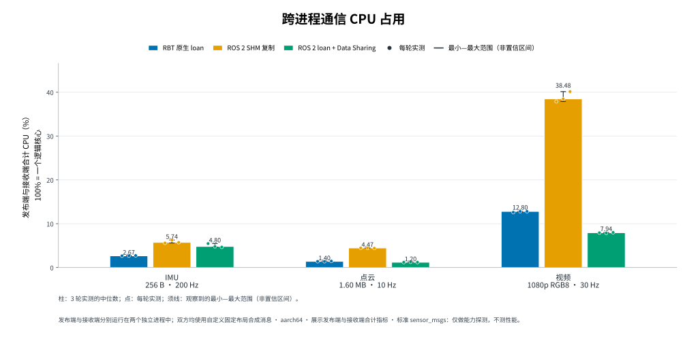
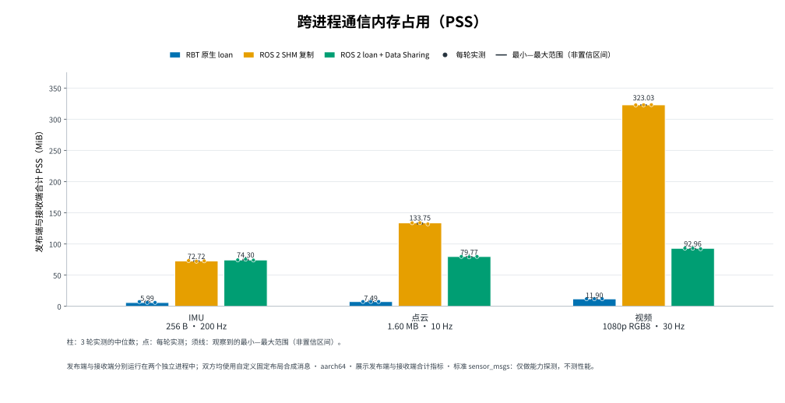

# RBT

[文档](docs/README.md) · [快速上手](#快速上手) · [示例](examples/README.md) · [性能实测](#rbt-and-ros-2-transport-measurements)

RBT 为机器人程序提供进程间通信和组件管理，支持 Rust、C++20 和 Python / NumPy。
它使用 [iceoryx2](https://github.com/eclipse-iceoryx/iceoryx2) 在 Linux 本机进程间通过共享内存传递数据。

<a id="why-use-rbt-on-top-of-iceoryx2"></a>

## 功能

- 图像和点云支持共享内存零拷贝，载荷长度可在配置容量内变化。
- 用 IDL 定义消息，生成 Rust/C++ 绑定和 Python 元数据；通信端点打开时检查 ABI。
- 用 Composer 绑定组件依赖、管理生命周期，也可直接使用 SDK 发布、订阅和调用 RPC。
- 时间戳带有时钟身份，支持显式时钟映射；TF 可以按采集时间查询本地变换历史。
- 用 CLI 查看组件状态、依赖和流压力；用 MCAP 录制、回放 Image、PointCloud、ControlCommand。

## 运行方式

Composer 管理能力绑定与组件生命周期，组件进程通过共享内存直接交换数据。



## 快速上手

以下命令从源码构建 SDK 与命令行工具，并运行一个 Rust 发布 / 订阅应用。环境：**Linux x86_64、Rust 1.89+、Git**。

```bash
git clone https://github.com/sunwen-me/rbt.git
cd rbt
./scripts/bootstrap_iceoryx2_rbt.sh --source-only
cargo build --locked -p rbt-cli -p rbt-idl -p composer

export PATH="$PWD/target/debug:$PATH"
export RBT_RUST_SDK="$PWD"
rbt doctor
```

在源码目录之外创建项目：

```bash
mkdir -p ../rbt-work
cd ../rbt-work
rbt new hello-robot
cd hello-robot
rbt check
rbt run
```

组件进入 `ACTIVE` 后，终端会持续输出 `HELLO sequence=...`。按 Ctrl-C 停止应用。
在另一个终端进入项目目录，可以查看运行状态：

```bash
rbt ps
rbt graph
rbt why hello-sink
```

继续阅读[快速入门](docs/quickstart.md)，添加消息、创建组件并替换提供者；多语言 SDK 的构建与安装见[分发指南](docs/distribution.md)。

<a id="rbt-and-ros-2-transport-measurements"></a>

## 跨进程通信实测

### 开发机 · x86_64

RBT SDK 0.8.0 与 ROS 2 Lyrical / Fast DDS 3.6.2，在 Intel Core Ultra 5 125H、Linux x86_64 上运行独立的发布和订阅进程。
两侧使用相同的合成定长消息、填充与校验方式，队列深度为 1；每组预热 3 秒、测量 15 秒，重复 3 次。

下表为三次试验的中位数：**两进程 CPU 合计 / PSS 内存合计（MiB）**。CPU 100% 对应一个逻辑核心。

| 工作负载 | RBT 原生 loan | ROS 2 SHM（拷贝） | ROS 2 loan + Data Sharing |
|---|---:|---:|---:|
| IMU 尺寸 · 256 B · 200 Hz | 3.00% / **7.01** | 1.60% / 35.28 | 1.40% / 35.27 |
| 点云尺寸 · 1.60 MB · 10 Hz | 0.27% / **8.44** | 1.20% / 96.46 | 0.60% / 39.88 |
| 原始视频尺寸 · 1080p RGB8 · 30 Hz | 2.73% / **12.94** | 9.80% / 286.16 | 2.73% / 53.21 |

27 次试验均达到目标速率，投递率为 100%。这组配置下，RBT 的 PSS 在三个场景中均更低；CPU 表现随负载变化。

<details>
<summary>查看 CPU 与内存图表</summary>

柱形为中位数，圆点为三次试验，误差线为最小值至最大值。





</details>

[完整报告与原始数据](benchmarks/ros2_transport/results/2026-10-29/README.md) · [复现实验](benchmarks/ros2_transport/README.md)

### QCS8550 板端 · ARM64

2026-10-31 在 QCS8550（AidLux Ubuntu 22.04、ROS 2 Humble / Fast DDS 2.6.11）补测相同的 27 轮实验。
发布与订阅进程固定允许使用 CPU 3、4，已有 IMU、感知服务保持运行。统计口径同上：**两进程 CPU 合计 / PSS 内存合计（MiB）**。

| 工作负载 | RBT 原生 loan | ROS 2 SHM（拷贝） | ROS 2 loan + Data Sharing |
|---|---:|---:|---:|
| IMU 尺寸 · 256 B · 200 Hz | 1.53% / 5.80 | 5.07% / 22.89 | 4.13% / 22.93 |
| 点云尺寸 · 1.60 MB · 10 Hz | 0.53% / 7.32 | 2.00% / 82.73 | 0.80% / 27.48 |
| 原始视频尺寸 · 1080p RGB8 · 30 Hz | 2.60% / 11.72 | 13.94% / 268.36 | 2.53% / 40.73 |

27/27 轮有效，均达到目标频率、投递率 100%；RBT 与 ROS loan 每轮均验证了 8 个共享缓冲区地址样本。
本组配置下 RBT 的 PSS 更低，视频 CPU 与 ROS loan 接近。这里使用相同尺寸的合成定长消息；标准 `sensor_msgs` 在该板端安装中报告不支持 loan。
板端与开发机使用不同的 ROS、内核和背景负载，不能直接用两表推断处理器性能差距。

<details>
<summary>查看 QCS8550 CPU 与内存图表</summary>





</details>

[QCS8550 完整报告、逐轮数据与复现方法](benchmarks/ros2_transport/results/2026-10-31-qcs8550/README.md)

### Raspberry Pi 4 板端 · ARM64

2026-11-10 在 Raspberry Pi 4 Model B Rev 1.2（Ubuntu 26.04、Linux 7.0.0-1009-raspi、ROS 2 Lyrical / Fast DDS 3.6.2）完成同一组 27 轮实验。两个端点允许使用 CPU 2、3，保持默认 `ondemand` governor；每轮预热 3 秒、测量 15 秒，重复 3 次并轮换模式顺序。表中为三次试验的中位数：**两进程 CPU 合计 / PSS 内存合计（MiB）**。

| 工作负载 | RBT 原生 loan | ROS 2 SHM（拷贝） | ROS 2 loan + Data Sharing |
|---|---:|---:|---:|
| IMU 尺寸 · 256 B · 200 Hz | 2.67% / **5.99** | 5.74% / 72.72 | 4.80% / 74.30 |
| 点云尺寸 · 1.60 MB · 10 Hz | 1.40% / **7.49** | 4.47% / 133.75 | 1.20% / 79.77 |
| 原始视频尺寸 · 1080p RGB8 · 30 Hz | 12.80% / **11.90** | 38.48% / 323.03 | 7.94% / 92.96 |

27/27 轮有效，均达到目标频率、投递率 100%；RBT 与 ROS loan 每轮均验证 8 个共享缓冲区地址样本。此配置下 RBT 的 PSS 较低；RBT 的 IMU CPU 中位数更低，点云场景 ROS loan 略低，视频场景 ROS loan 明显低于 RBT。标准 `sensor_msgs` 的 loan 能力探测均报告不支持；测试使用的是合成定长消息，不是实际传感器流。板端 sysfs 遥测记录的温度为 38.946–43.816 °C、CPU 频率为 600 MHz–1.5 GHz；固件 throttling 标志不可读取，报告不据此判断是否发生 throttling。

视频 CPU 差距主要来自 RBT 默认 `loan()` 在填充数据前先初始化整帧；独立诊断确认了这次额外清零的成本。这里保留原始接口行为及正式成绩，诊断对照仅用于解释原因，详见[视频 CPU 原因与证据](benchmarks/ros2_transport/results/2026-11-10-raspberrypi4/README.md#why-video-cpu-is-higher-than-ros-loan)。

<details>
<summary>查看 Raspberry Pi 4 CPU 与内存图表</summary>





</details>

[Raspberry Pi 4 完整报告、逐轮数据与环境遥测](benchmarks/ros2_transport/results/2026-11-10-raspberrypi4/README.md)

## 文档

| 从这里开始 | 深入使用 |
|---|---|
| [快速入门](docs/quickstart.md) | [组件编写](docs/component-authoring.md) · [架构](docs/architecture.md) |
| [Rust SDK](docs/rust-sdk.md) · [C++ SDK](docs/cpp-sdk.md) · [Python SDK](docs/python.md) | [IDL](docs/idl.md) · [消息 ABI](docs/abi.md) · [RPC](docs/rpc.md) |
| [命令行工具](docs/cli.md) · [调试](docs/debugging.md) | [时间](docs/time.md) · [TF](docs/tf.md) · [MCAP](docs/mcap.md) |
| [示例项目](examples/README.md) | [构建与开发](docs/development.md) · [SDK 分发](docs/distribution.md) |

完整索引见[文档中心](docs/README.md)。欢迎通过 [Issues](https://github.com/sunwen-me/rbt/issues) 反馈问题，通过 [Pull Requests](https://github.com/sunwen-me/rbt/pulls) 贡献代码与文档。

## 许可证

RBT 采用 [MIT](LICENSE-MIT) 或 [Apache-2.0](LICENSE-APACHE) 双许可证，任选其一。
