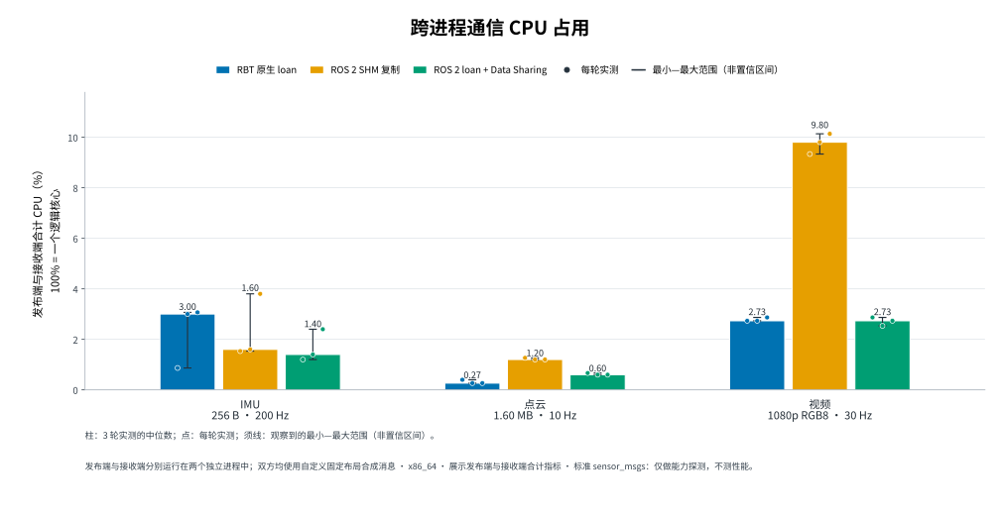
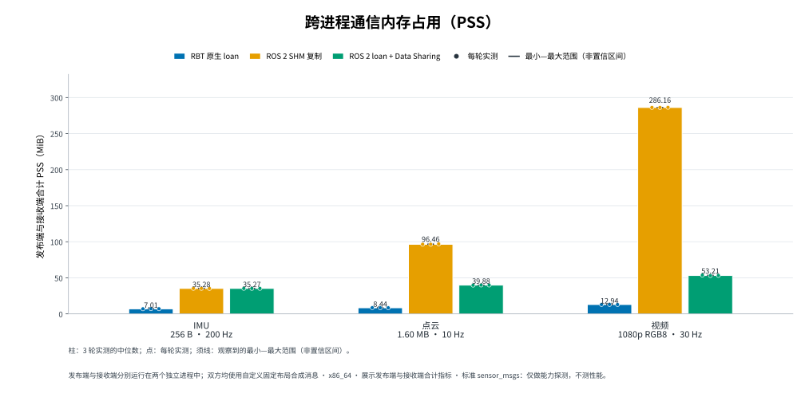

# rbt

`rbt` 是基于 iceoryx2 构建的零拷贝、面向能力的机器人运行时。
Composer（编排器）决定运行哪些组件；带类型的数据负载通过共享内存在组件进程之间直接传递。
Composer 不会进入负载传输路径。

RBT 面向 Linux 同机多进程机器人应用，适用于图像、点云和控制等负载。应用可直接使用
Rust、C++ 或 Python SDK，也可按需由 Composer 编排组件；目标是在高性能本地 IPC 之上，
提供机器人消息、生命周期、时间与资源边界契约。

本仓库提供可安装的 v0.8 实机运行时，以及面向 Rust、C++20 和 CPython/NumPy
发布者与订阅者的 SDK。仓库包含生命周期运行时、生成的消息绑定、运行时诊断、
外部消费者安装测试、多语言故障测试、长时间稳定性测试，以及可重复执行的验证
和基准测试工具。

本仓库负责框架核心：运行时 crate、Rust/C++/Python SDK、IDL 与生成绑定、时间和
TF 契约、Composer，以及 `rbt` CLI。当前仓库范围见[项目状态](PROJECT_STATUS.md)。
机器人专用的驱动、导航和感知模块位于独立的机器人工作区；本地开发布局中，
该工作区是相邻检出目录 `../rbt_robot_ws/`。

开发新应用时，请从[快速入门](docs/quickstart.md)开始：
`rbt doctor` → `rbt new` → `rbt check` → `rbt run`。由工具生成项目是受支持的入门
路径；下方的 Rust/C++ 混合命令属于进阶参考和回归工作流。

准备本地 SDK、源码和 Python wheel 包的贡献者可参考[分发指南](docs/distribution.md)。

本地机器人工作区中的 Orbbec Gemini 335 和 M3T 集成指南位于
`../rbt_robot_ws/drivers/orbbec/` 和 `../rbt_robot_ws/perception/m3t/`。

<a id="why-use-rbt-on-top-of-iceoryx2"></a>

## 为什么在 iceoryx2 之上使用 rbt？

[iceoryx2](https://github.com/eclipse-iceoryx/iceoryx2) 提供原生共享内存零拷贝、分配器、
loan/borrow、发布/订阅、请求/响应、事件与 WaitSet、服务发现和传输资源清理。RBT 使用
这些通用 IPC 基础，并在其上增加机器人应用间共享的契约。

iceoryx2 维护者在[设计讨论 #1711](https://github.com/eclipse-iceoryx/iceoryx2/discussions/1711)
中强调，零拷贝优先还需要明确载荷生命周期、背压、进程崩溃恢复和任务执行约束。
RBT 沿用这一设计思路，把这些边界落实为可复用、可检查的机器人应用接口；性能数据
单独列在后文的跨进程实测中。

| iceoryx2 提供 | RBT 增加 |
|---|---|
| 原生共享内存、分配器和 slice loan | Image 与 PointCloud 使用固定头部加连续可变长载荷，容量范围内按实际长度借用，便于跨进程传递图像和点云（[消息定义](types/sensor.rbt)、[ABI](docs/abi.md)） |
| 原生 loan/borrow | Rust/C++ 通过样本守卫管理借用与释放；Python 接收视图只读，发送前会拒绝仍有可写 NumPy 别名的 loan，将样本生命周期落实到 SDK 接口（[C++ 所有权](docs/cpp-sdk.md#data-plane-ownership)、[Python 所有权](docs/python.md#writable-aliases-and-send)） |
| 原生多语言通信基础 | IDL 生成 Rust/C++ 消息绑定和 Python 扩展所用的 descriptor/dtype 元数据，并在打开端点前检查完整 ABI（[IDL](docs/idl.md)、[ABI](docs/abi.md)） |
| 传输队列、投递结果和资源限制 | Sensor 队列深度为 1，满时替换最旧未读样本；Control 深度为 4，队列满返回 `QueueFull`，但可能已有其他订阅者收到样本。loan/borrow 有界，耗尽有类型错误；底层 OOM 会映射为 `LoanPoolExhausted`（[背压语义](docs/runtime-pressure.md)） |
| 原生事件和 WaitSet | 实验性 `WaitContext` 将消息就绪、超时和激活取消纳入同一等待；空闲时阻塞，收到事件后处理消息，应用无需自行编写定时轮询循环（[事件等待](docs/waiting.md)） |
| 服务发现与传输端点清理 | Composer 按类型绑定能力；`EffectScope` 在激活结束时取消并等待托管任务退出，清理端点和能力。关键任务异常退出会使本次激活失效；健康激活期间 Composer 暂不可用，本地数据流仍可继续（[架构](docs/architecture.md)、[组件编写](docs/component-authoring.md)） |
| 传输应用负载 | 带时钟身份的采集时间与映射，以及消费者进程内按采集时间查询的本地 TF 历史（[时间](docs/time.md)、[TF](docs/tf.md)） |
| 原生事件和诊断基础 | CLI 查看应用图、`rbt why` 和流压力；可安装 SDK 与脚手架支持项目创建；MCAP 支持 Image、PointCloud、ControlCommand，TF 录制/回放尚未验证（[CLI](docs/cli.md)、[背压检查](docs/pressure.md)、[快速入门](docs/quickstart.md)、[分发](docs/distribution.md)、[MCAP](docs/mcap.md)） |

这些接口都有对应的现有测试场景：

- **样本所有权：** [Python 发布测试](python/tests/test_publishers.py)验证仍有可写别名时拒绝发送，[接收测试](python/tests/test_image.py)验证 NumPy 视图只读。
- **过载与等待：** [压力测试](crates/rbt-iox2/tests/pressure_semantics.rs)覆盖 loan/borrow 耗尽后恢复、快慢 Sensor 订阅者共存，以及 Control 部分订阅者收到消息后整体发送仍返回失败的情形；[WaitSet 测试](crates/rbt-iox2/tests/waitset.rs)覆盖空闲等待和取消唤醒。
- **故障与恢复：** [组件运行时测试](crates/rbt-compose/src/component.rs)覆盖关键任务失败后的激活撤销与任务回收；[混合运行时测试](scripts/test_mixed_runtime.sh)检查 Composer 被 SIGKILL 后数据继续传输，恢复时保持 `0 deactivate, 0 activate`。
- **跨语言与安装：** [C++ 描述符测试](sdk/cpp/tests/descriptor_tests.cpp)检查完整 ABI，[安装测试](scripts/test_install.sh)覆盖已安装 SDK 和生成应用的运行流程。

负载始终走原生共享内存路径；Composer 负责图和生命周期控制，不会转发样本。当前
维护的原生基线 iceoryx2 `0.10.0-rbt.2` 由六个[受跟踪补丁](third_party/iceoryx2-rbt/README.md)
重建。这些底层修复也可以脱离 RBT 上层直接使用。

RBT 增加了消息结构检查、诊断、可选控制平面和维护成本。目前没有同条件基准测试证明
RBT 比直接调用原生 iceoryx2 更快。进程固定的小型应用可能更适合直接使用原生 API；
不断扩展的混合机器人系统则可从统一的消息、生命周期、时间和 TF 契约中受益。相邻
机器人工作区目前混合采用这些能力：底盘、IMU 和导航主要使用独立的 RBT SDK 端点，
并按需使用时间、TF 或清理机制，而不是由 Composer 管理应用图。

<a id="rbt-and-ros-2-transport-measurements"></a>

## RBT 与 ROS 2 跨进程通信实测

2026-10-29 进行的同条件双进程实验比较了 RBT SDK 0.8.0 与 ROS 2 Lyrical / Fast DDS 3.6.2，
测试主机为 Intel Core Ultra 5 125H Linux x86_64。发布者和订阅者运行在两个独立进程中。
每个用例使用相同的合成固定布局消息、负载填充和稀疏校验，尽力而为 QoS、队列深度 1，
每种配置重复三次，预热 3 秒，测量 15 秒。下表为重复试验的中位数：**发布者与订阅者
CPU 合计百分比 / PSS 合计 MiB**。CPU 100% 表示占用一个逻辑核心。

柱形表示中位数，圆点表示全部三次试验，误差线表示观测到的最小值至最大值范围。
两张图均使用从零开始的线性坐标轴。





| 工作负载 | RBT 原生 loan | ROS 2 SHM 传输（拷贝） | ROS 2 loan + Data Sharing |
|---|---:|---:|---:|
| IMU 尺寸：256 B，200 Hz | 3.00% / 7.01 | 1.60% / 35.28 | 1.40% / 35.27 |
| 点云尺寸：1.60 MB，10 Hz | 0.27% / 8.44 | 1.20% / 96.46 | 0.60% / 39.88 |
| 原始视频尺寸：1080p RGB8，30 Hz | 2.73% / 12.94 | 9.80% / 286.16 | 2.73% / 53.21 |

全部 27 次试验均达到目标速率，投递率为 100%，未检测到负载或序号错误。RBT 和 ROS
loan 的每轮试验都验证了八组序号匹配的共享缓冲区映射；ROS loan 计数与实测收发样本数一致。
在这些配置中，RBT 的 PSS 更低。CPU 结果因场景而异：两条 loan 路径的视频 CPU
使用率相近，而 IMU 的 CPU 使用率波动较大（RBT 为 0.87–3.07%）。缓冲区大小以及
节点和运行时开销都会影响这些结果。

本测试使用自定义定长消息，不是标准 `sensor_msgs` 测试，也不是传感器驱动或整机基准
测试。在此 ROS 安装中，对标准 Image、PointCloud2 和 Imu 的 loan 能力探测均返回 false。
这不是 QCS8550 测量结果。详情、取值范围和逐次试验数据见[完整报告](benchmarks/ros2_transport/results/2026-10-29/README.md)，
复现方法见[操作说明](benchmarks/ros2_transport/README.md)。

**RBT 在跨进程原生传感器传输方面的实用优势：** 现有的
[`Image` 和 `PointCloud` schema](types/sensor.rbt) 支持在配置容量内传输连续的
可变长度负载，并可直接[借用和接收](docs/cpp-sdk.md#data-plane-ownership)。应用可在
iceoryx2 共享内存路径上使用这些原生传感器契约；在本次测试的 ROS 2/Fast DDS 配置中，
标准 `sensor_msgs` 不支持原生 loan。RBT schema 有自己的布局；驱动或格式转换仍可能
拷贝数据。性能表比较的是两套栈上的匹配自定义消息；没有测量标准消息的 CPU 或内存。

ROS 2 也支持**进程内零拷贝**：同一进程中的兼容节点可以通过 `rclcpp` 转移消息所有权，
包括标准传感器消息，而无需原生 DDS loan（[官方图像示例](https://github.com/ros2/demos/blob/lyrical/intra_process_demo/include/image_pipeline/camera_node.hpp)）。
这条路径取决于发布/订阅的所有权模式和图结构。上方双进程基准测试显式禁用了
`use_intra_process_comms`，没有测量这种部署方式。中间件的 `can_loan` 返回 false，
并不能排除 ROS 2 进程内零拷贝。

<a id="install-and-run-the-first-graph"></a>

## 安装并运行第一个应用图

仅使用 Rust 的入门路径需要 Rust 1.89+ 和 Linux x86_64 主机。从源码检出目录开始，先构建
生成的应用图所需的三个工具，将此检出目录设为 SDK，再运行 doctor 检查环境：

```bash
./scripts/bootstrap_iceoryx2_rbt.sh --source-only
cargo build --locked -p rbt-cli -p rbt-idl -p composer
export PATH="$PWD/target/debug:$PATH"
export RBT_RUST_SDK="$PWD"
rbt doctor
```

已安装的发行版会提供相同的三个可执行文件和配套 Rust SDK，因此无需设置环境变量。
运行第一个应用图不需要 C++、Python 或 NumPy；完整的多语言安装流程见下文和[安装测试](docs/testing.md)。

在当前检出目录之外创建并运行一个实际项目：

```bash
mkdir -p /tmp/rbt-work
cd /tmp/rbt-work
rbt new hello-robot
cd hello-robot
rbt check
rbt run
```

生成的源组件和接收组件会进入 `ACTIVE` 状态并打印 `HELLO` 样本。在第二个终端运行
`rbt ps`、`rbt graph` 和 `rbt why hello-sink`；在启动器终端按 Ctrl-C 停止并回收应用图。
请参阅[快速入门](docs/quickstart.md)，了解消息/组件创建、提供者替换、流背压以及
MCAP 录制/回放。接下来可阅读[项目布局指南](docs/project-layout.md)和
[组件编写指南](docs/component-authoring.md)。

直接从检出目录开发而非使用已安装前缀时，请保留 `RBT_RUST_SDK`，直到运行完
`rbt new`，以便生成的清单记录明确的 SDK 路径。

如需固定的本地请求/响应能力，请参阅 [Rust RPC 入门示例](docs/rpc.md)。示例演示由激活
拥有的服务端/客户端端点、借用的请求/响应负载、有界截止时间，以及不让 Composer 进入
负载路径的取消机制。

<a id="real-hardware-timestamps"></a>

## 实机时间戳

有关带标识的主机/设备时间戳、经过检查的算术运算、设备重置代次以及显式校准映射，请参阅
[时间指南](docs/time.md)。`rbt time status --json` 可在不依赖 Composer 的情况下读取
本地时钟诊断信息。`rbt::time_stream::StampedBytes`、C++ `rbt/time_stream.hpp` 和
Python `rbt.time_stream` 会在同一个原生样本中携带采集与接收元数据。未知采集时间仍保持
未知；旧版 Image/PointCloud 时间戳保留现有 ABI，且不隐含任何时钟域保证。

[实体 V4L2 相机示例](examples/09-time-camera/README.md)需要明确指定设备。运行
`scripts/verify_time.sh --quick` 或 `--full`；硬件验收需单独运行
`--hardware --device /dev/video0`。结果记录在[时间报告](docs/time-report.md)中。

<a id="spatial-transforms"></a>

## 空间变换

已验收的 v0.8 软件版本包括经过验证的 3D 变换、显式坐标系方向、有界本地历史、按采集
时间查询、静态快照恢复，以及 Rust/C++/Python API；详情见 [TF 指南](docs/tf.md)。
软件验证记录在 [TF 验收报告](docs/tf-report.md)中；实体相机 TF 硬件验收仍未执行。

使用以下命令运行本地配置示例：
`cargo run -p rbt-tf-local -- --config docs/tf-config-example.toml`。
[相机/TF 示例](examples/10-tf-camera/README.md)需要明确选择设备并提供外参；配置值本身
并不能证明实际标定精度。TF 查询仅在各消费者进程内部执行。

<a id="advanced-mixed-language-reference"></a>

## 多语言进阶参考

仓库中的其余示例和发行门禁还需要 CMake 3.22+、C++20 编译器、Git、Ninja，以及统一的
iceoryx2 0.10.0-rbt.2 C++ 绑定。

<a id="1-build-the-mixed-fixtures"></a>

### 1. 构建多语言测试组件

```bash
./scripts/bootstrap_iceoryx2_cpp.sh
export RBT_PHASE4_TOOLCHAIN="${RBT_PHASE4_TOOLCHAIN:-$PWD/target/phase4-toolchain}"
export CXX="$RBT_PHASE4_TOOLCHAIN/bin/x86_64-conda-linux-gnu-g++"
export LD_LIBRARY_PATH="$RBT_PHASE4_TOOLCHAIN/lib:$PWD/target/iox2-rbt-0.10.0-cpp-install/lib${LD_LIBRARY_PATH:+:$LD_LIBRARY_PATH}"
cargo build -p camera-a -p viewer
cmake -S sdk/cpp -B target/v01-cpp-debug -G Ninja \
  -DCMAKE_BUILD_TYPE=Debug \
  -DCMAKE_CXX_COMPILER="$CXX" \
  -DCMAKE_PREFIX_PATH="$PWD/target/iox2-rbt-0.10.0-cpp-install"
cmake --build target/v01-cpp-debug --target detector_component
```

统一的原生引导流程使用 `target/phase4-toolchain`；如需使用其他已配置的工具链目录，
请通过 `RBT_PHASE4_TOOLCHAIN` 选择。

构建并安装 Python 数据 SDK：

```bash
python -m build --wheel python
python -m venv /tmp/rbt-python
/tmp/rbt-python/bin/pip install python/dist/rbt-0.8.0-*.whl
```

```python
import rbt

sub = rbt.ImageSubscriber.open(
    rbt.StreamDescriptor.image("rbt/camera/image")
)
sample = sub.receive()
image = sample.numpy()
print(image.shape)
```

`image` 是借用的只读 NumPy 视图。它通过基对象持有接收的共享内存样本，不会复制负载。

Python 发布者使用明确的 loan/mapping/send 顺序。发布者和 loan 必须保持存活；删除所有
可写 NumPy 别名后，再调用 `loan.send()`。如果发送时仍有别名存在，操作会被拒绝，不会
悄悄改为拷贝。

<a id="2-start-a-mixed-rustc-graph"></a>

### 2. 启动 Rust/C++ 混合应用图

从仓库根目录开始，在各自的终端中分别运行这些命令：

```bash
target/debug/composer
target/debug/camera-a
target/v01-cpp-debug/detector_component
target/debug/viewer
```

运行中的应用图如下：

```text
Rust Camera -- Camera/Image --> C++ Detector -- Detections/Detection --> Rust Viewer
```

如需使用其他控制地址，请在所有终端中一致地设置
`RBT_COMPOSER_ADDR=127.0.0.1:7555`。

<a id="3-inspect-it"></a>

### 3. 检查运行状态

```bash
rbt ps
rbt graph
rbt capability list
```

`rbt ps` 会报告组件、进程、激活、生命周期状态和控制连接。`rbt graph` 会显示已解析的
两条边。从 `rbt capability list` 复制能力 UUID 或端点，再检查其 ABI 和队列策略：

```bash
rbt stream info <capability-id-or-service>
```

可通过 `rbt ps --json` 和 `rbt capability list --json` 获取机器可读视图；图输出支持
`--dot`。

<a id="4-remove-and-replace-the-provider"></a>

### 4. 移除并替换提供者

终止 Rust 相机进程，再向 Composer 查询检测器停止的原因：

```bash
kill -KILL <camera-a-pid>
rbt why detector
```

由于 `Camera` 没有活动提供者，检测器会变为 `BLOCKED`，查看器也会随之变为 `BLOCKED`。
启动替代测试组件：

```bash
cargo run -p camera-b
rbt ps
rbt graph
```

现有 C++ 检测器进程会针对新能力重新激活。它的进程身份和已准备好的模型保持不变；
其 `ActivationId` 和激活所拥有的输出 `CapabilityInstanceId` 会更新。

在应用图运行期间重启 Composer：

```bash
composer_pid="$(pgrep -n -x composer)"
kill -KILL "${composer_pid}"
target/debug/composer
rbt ps
rbt graph
```

故障期间，组件进程和共享内存端点会继续运行。重新连接并重建快照后，新 Composer 会
恢复相同的应用图，结果为 `0 deactivate, 0 activate`；进程、激活和能力身份均保持不变。

包含 Composer 重启和关键任务故障的完整自动化版本如下：

```bash
./scripts/test_mixed_runtime.sh
```

<a id="frozen-runtime-semantics-inherited-from-v01"></a>

## 从 v0.1 沿用并冻结的运行时语义

v0.1 运行时冻结了以下架构边界：

1. Composer 故障不代表提供者故障。
2. 能力仅在其所属激活有效期间存在。
3. 关键任务故障会使其激活失效，并撤销端点和能力；后台任务故障不会。
4. Composer 正常恢复时会导入完整快照并重建现有应用图，而不是重新创建应用图。
5. 负载绝不经过 Composer。
6. 本地共享内存消息 ABI 不是网络传输格式。

准备阶段属于进程级工作。激活拥有已解析的绑定、流、能力、任务和清理逻辑。
Rust 和 C++ 实现相同契约；Python 将生命周期和任务所有权交给该运行时。在 Composer
正常重启期间，进程会继续传输数据、重新连接并完成协调，结果为
`0 deactivate, 0 activate`。

v0.8 发行版各自独立的版本轴如下：

| 版本轴 | 值 |
| --- | ---: |
| SDK | `0.8.0` |
| IDL 语言 | `1` |
| 消息描述符格式 | `1` |
| 控制协议 | `2` |
| Composer 快照 | `4` |
| MCAP/文件编码 | `1` (`rbt-canonical-v1`) |

控制协议和快照版本必须精确匹配。生成器/SDK 版本不参与冻结的消息布局哈希计算。

<a id="public-sdks"></a>

## 公共 SDK

Rust 应用通常依赖 `crates/rbt`，并使用其中精选的 `component`、`control`、`stream`、
`types`、`rpc`、`time`、`time_stream` 和 `tf` 模块。其 prelude 刻意保持精简；公共
边界使用有类型的错误，而不暴露内部 `anyhow` 错误。

C++ 应用包含 `include/rbt` 下的头文件，实现 `rbt::Component`，并通过
`rbt::ComponentRuntime` 运行。激活任务由 `EffectScope` 拥有，使用
`std::jthread`/`std::stop_token`，并在按 LIFO 顺序清理时等待任务结束。已安装的消费者使用：

```cmake
find_package(rbt CONFIG REQUIRED)
target_link_libraries(my_node PRIVATE rbt::runtime rbt::iox2)
```

运行 `./scripts/test_install.sh` 可将软件安装到临时前缀、验证安装后的文档/许可证，
使用暂存的 `rbt`/`rbt-idl`/Composer 创建并运行生成的 Rust 应用图，并在仓库外构建全新的
Rust 与 C++ 消费者。生成的项目和 Rust 消费者只解析暂存的公共 SDK；C++ 消费者解析已
安装的 CMake 软件包。

Python 消费者使用 `rbt.ImageSubscriber` 和 `rbt.PointCloudSubscriber`，发布者使用
`rbt.ImagePublisher` 和 `rbt.PointCloudPublisher`。接收得到的 NumPy 视图会持有原生接收
保护对象，并保持只读；发布者视图可写但不拥有数据，发送前必须释放所有别名。两个方向
都会在释放 GIL 的同时使用现有的事件驱动 WaitSet。Python 也可以继承 `rbt.Component`；
同步和 asyncio 适配器都会将生命周期、身份、取消和组合交由现有 Rust 运行时处理。
Python 包还提供有类型的 RPC、带标识的时间和带时间戳的负载，并通过 `rbt.tf` 提供本地 TF。

<a id="mcap-record-inspect-and-play"></a>

## MCAP 录制、检查和播放

将一组固定的受支持活动能力录制为有界旁路订阅者；无需 Composer 即可检查文件，并通过
全新的原生 Component 身份回放：

```bash
rbt record --output run.mcap --capability Camera
rbt record --output mixed.mcap --all --duration 10
rbt mcap info mixed.mcap --json
rbt play mixed.mcap --rate 1.0
rbt play mixed.mcap --rate 2.0
rbt play mixed.mcap --rate 0
```

Image、PointCloud 和 ControlCommand 使用由 IDL 生成的规范持久化字节，而不是原始
`repr(C)` 内存。MCAP `log_time` 驱动一个全局单调回放计划；负载内的消息时间戳保持不变。
Sensor 录制器溢出会显式报告并将文件标记为不完整；Control 丢失和非事务性回放发送错误
则属于终止错误，不会重试。详见 [MCAP 录制与播放](docs/mcap.md)。

<a id="examples"></a>

## 示例

```text
examples/
├── rust/
│   ├── camera/          Rust provider (`camera-a` package)
│   ├── detector/        Rust detector alternative
│   ├── viewer/          Rust consumer
│   └── composer/        Composer binary package
├── cpp/
│   ├── camera/          C++ Camera component
│   ├── detector/        C++ detector used by the mixed test
│   ├── viewer/          C++ viewer component
│   └── python-viewer/   C++ consumer for Python-provided PointCloud
├── python/
│   ├── component_detector.py Rust Camera -> Python -> C++ example
│   ├── image_stats.py   borrowed Image checksum example
│   └── pointcloud_stats.py structured PointCloud centroid example
├── interop/
│   ├── rust-image-cpp-consumer/
│   ├── cpp-pointcloud-rust-consumer/
│   └── phase4-runtime/  shared executable harness
└── advanced/            replacement, MCAP source, and low-level transport fixtures
```

这些 C++ 示例还包含独立的 `CMakeLists.txt` 文件，可配合已安装的软件包使用。底层
Phase 4 测试组件仍保留在 `advanced`/`interop` 下，但不再主导公开示例的布局。

<a id="build-generate-verify"></a>

## 构建、生成和验证

有关仓库职责、原生引导、语言构建、生成产物以及如何为变更选择检查，请参阅
[框架开发指南](docs/development.md)。Cargo 和 CMake 用于构建实现；`rbt` CLI 用于
搭建项目、委托构建/运行并检查运行时状态。

一次性重新生成四个正式 schema：

```bash
cargo run --locked -p rbt-idl -- generate \
  types/sensor.rbt types/control.rbt types/demo.rbt types/tf.rbt \
  --rust generated/rust \
  --cpp generated/cpp \
  --descriptor generated/descriptors \
  --python python/rbt/_generated
```

执行 v0.8 集成软件验证时，选择所需模式：

```bash
./scripts/verify_tf.sh --quick
# Release acceptance, including inherited full gates:
./scripts/verify_tf.sh --full
```

汇总 TF 门禁依次继承 Time 和 RPC。完整模式包含现有的生命周期、WaitSet、背压、Python、
MCAP、DX、安装、互操作和长时间稳定性测试。在开发过程中，请根据变更使用受影响软件包
或子系统的[测试](docs/testing.md)；文档变更需要检查命令、API 和链接。SDK 注册了 12 个
CTest 用例，其中 4 个专门测试 TF。实体设备门禁单独执行，并要求明确选择设备。

<a id="documentation"></a>

## 文档

**[开发者文档索引](docs/README.md)** 是当前 v0.8 指南和保留发行证据的完整入口。

| 从这里开始 | 用途 |
| --- | --- |
| [快速入门](docs/quickstart.md) | 生成、检查并运行第一个应用 |
| [框架开发](docs/development.md) | 仓库结构、构建、代码生成和定向验证 |
| [架构](docs/architecture.md)与[概念](docs/concepts.md) | 平面、生命周期、身份、所有权和恢复 |
| [组件编写](docs/component-authoring.md)与[项目布局](docs/project-layout.md) | 需求、绑定、任务、取消和项目文件 |
| [Rust](docs/rust-sdk.md)、[C++](docs/cpp-sdk.md)、[Python](docs/python.md) | 语言 API 和原生所有权 |
| [RPC](docs/rpc.md)、[时间](docs/time.md)、[TF](docs/tf.md) | 有类型的请求、采集时间语义和本地变换查询 |
| [IDL](docs/idl.md)与[ABI](docs/abi.md) | 规范 schema、生成绑定和冻结布局 |
| [CLI](docs/cli.md)与[调试](docs/debugging.md) | 应用图、流、RPC、时间和 TF 诊断 |
| [示例](examples/README.md)与[测试](docs/testing.md) | 可运行的学习路径和验证范围 |
| [兼容性](docs/compatibility.md) | 产品、协议、文件格式和原生版本轴 |

该索引将维护中的指南与历史调查和报告分开。[v0.8 TF 报告](docs/tf-report.md)是当前
的软件验收记录；较早的报告保留其原始版本和测试结果。

本项目采用 MIT 或 Apache-2.0 许可证。第三方来源信息列于
`THIRD_PARTY_NOTICES.md`；该文件属于工程告知材料，并非法律意见。

<a id="scope-after-v08"></a>

## v0.8 之后的范围

仿真器时间、Parameters、网络网关或跨主机 TF、ROS 2 桥接、标定求解器、全局 TF 查询服务、
schema 演进/迁移以及自适应分配器重设计均不在本次发行范围内。显式的有界 loan/borrow
调优见[背压指南](docs/pressure.md)。基准测试结果需要同时提供记录的方法和环境元数据；
详见[基准测试方法](docs/benchmarks.md)。GPU/DMA-BUF 端到端零拷贝和功能安全认证也尚未建立；
上游 iceoryx2 的愿景不等于 RBT 已交付功能。
