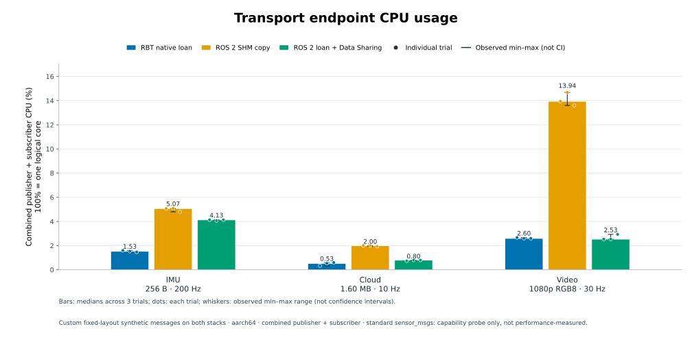
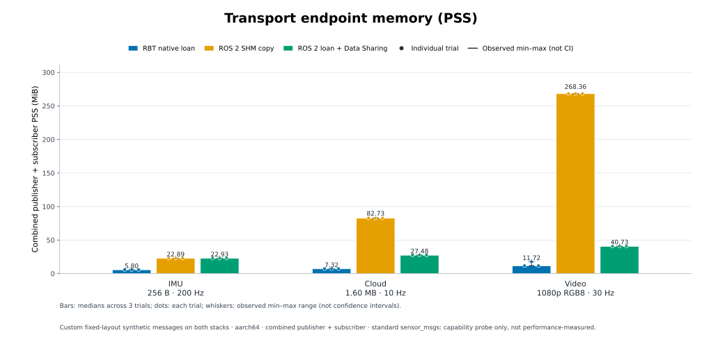

# QCS8550 RBT / ROS 2 transport measurements — 2026-10-31

**27/27 formal trials passed**: all target rates were reached with 100%
delivery and no detected payload or sequence errors. Both loan paths
passed sampled shared-buffer alias checks in every trial.

This report adds an ARM64 board measurement to the separate
[x86_64 result](../2026-10-29/README.md). The workloads and resource-accounting
method remain the same; the installed ROS distribution differs, so the two
reports are not a controlled comparison of processor architectures.

## Environment and workload

| Item | Board configuration |
|---|---|
| Board | QCS8550; device tree `Qualcomm Technologies, Inc. KalamaP HDK`, SoC machine `QCS_KALAMAP` |
| OS / architecture | AidLux Ubuntu 22.04.2 LTS, Linux 5.15.148-qki-consolidate-android13-8-g46a318bb187f-dirty, aarch64, glibc 2.35 |
| Memory | 15,543,596 KiB reported total RAM |
| CPU placement | Both endpoint processes allowed CPUs 3 and 4, capacity 855/1024, 2.8032 GHz advertised maximum, `performance` governor; no isolation or frequency changes |
| RBT | Installed ARM64 SDK 0.8.0, standalone C++ endpoints, no Composer; iceoryx2 0.10.0-rbt.2 |
| ROS | Humble; rclcpp 16.0.19; rmw_fastrtps_cpp/shared_cpp 6.2.10; Fast DDS 2.6.11; Fast CDR 1.0.29; sensor_msgs 4.9.1 |
| Build | Native GCC 11.4.0, CMake 3.22.1 Release, `-O3 -DNDEBUG`, C++20, Python 3.10.12 |
| Measured harness | [`b76f35886a76d92a91cc9eccc3c5effd3b9bb059`](https://github.com/sunwen-me/rbt/tree/b76f35886a76d92a91cc9eccc3c5effd3b9bb059/benchmarks/ros2_transport) |
| Schedule | 3 s warmup + 15 s measurement; three repetitions for each of three modes and workloads; rotated mode order |

Each message carries a 16-byte sequence/timestamp prefix followed by 256 bytes
at 200 Hz (IMU-sized), 1,600,000 bytes at 10 Hz (100k XYZI-point-sized), or
6,220,800 bytes at 30 Hz (uncompressed 1080p RGB8-sized). Both publishers
fully fill the payload. Both subscribers perform the same sparse validation.
These are synthetic fixed-layout messages, not real sensor data, standard
`sensor_msgs`, video encoding, navigation, or an end-to-end driver benchmark.

The existing IMU and perception processes were left running. Only benchmark
publisher/subscriber CPU and PSS are counted, excluding the collector and
background services. Scheduling and shared-library PSS can still be affected
by those services. Before/after environment snapshots record load, CPU
frequency and temperature; they do not continuously monitor throttling.

RBT uses Sensor queue depth 1, no history, two publisher loans and one
subscriber borrow. ROS uses best-effort, volatile, depth 1 and the same
four-sample plus two-extra pool used in the x86 report. SHM-copy maximum
message/segment sizes are 64 KiB/512 KiB (IMU), 2 MiB/8 MiB (cloud), and
8 MiB/32 MiB (video). ROS loan payloads use Data Sharing, with a
64 KiB/512 KiB SHM transport for discovery and other ROS traffic. Allocator
internals differ; these results do not establish universal memory ratios.

## CPU and memory results

Values are **median [min–max] of three repetitions**. CPU adds publisher and
subscriber; 100% represents one logical core. PSS adds both endpoints before
taking the median of the trial's approximately 1 Hz samples. Peak PSS is the
highest sampled sum, not an instrumented allocation peak. RSS remains in the
CSV and may count shared pages more than once. `/proc` CPU accounting uses
100 ticks/s over about 14.995 seconds; small CPU differences are not decisive.

| Workload | Path | CPU % | Combined PSS MiB | Sampled peak PSS MiB |
|---|---|---:|---:|---:|
| 256 B IMU-sized, 200 Hz | RBT native loan | 1.53 [1.47–1.60] | 5.80 [5.80–5.81] | 5.83 |
|  | ROS SHM copy | 5.07 [4.80–5.07] | 22.89 [22.88–22.90] | 22.92 |
|  | ROS loan + Data Sharing | 4.13 [4.07–4.13] | 22.93 [22.93–22.95] | 22.97 |
| 1,600,000 B cloud-sized, 10 Hz | RBT native loan | 0.53 [0.33–0.60] | 7.32 [7.32–7.32] | 8.08 |
|  | ROS SHM copy | 2.00 [1.93–2.00] | 82.73 [82.73–82.73] | 82.74 |
|  | ROS loan + Data Sharing | 0.80 [0.73–0.80] | 27.48 [27.48–27.51] | 27.51 |
| 6,220,800 B video-sized, 30 Hz | RBT native loan | 2.60 [2.60–2.67] | 11.72 [11.72–17.65] | 17.66 |
|  | ROS SHM copy | 13.94 [13.60–14.67] | 268.36 [268.35–268.37] | 268.37 |
|  | ROS loan + Data Sharing | 2.53 [2.53–2.93] | 40.73 [40.72–40.73] | 40.74 |

RBT used less PSS for all workloads in this configuration, and less CPU in
the IMU and cloud cases. Video CPU was similar for both loan paths
(RBT 2.60%, ROS loan 2.53% medians), well below SHM-copy's 13.94%.
The RBT video PSS medians varied from 11.72 to 17.65 MiB across trials;
that larger second-trial result is retained rather than discarded. This
experiment does not attribute that variation to a specific allocation cause.

Before/after 1-minute load averages were 1.01 and 0.68. CPUs 3 and 4 both
reported 2.8032 GHz and the performance governor in both snapshots. Available
CPU-labelled thermal sensors ranged 44.8–53.1 °C before and 41.6–49.1 °C
after. These snapshots do not establish that clocks or temperatures were
constant throughout each trial.





## Delivery and zero-copy evidence

Each repetition published and received exactly 3,000 IMU, 150 cloud and
450 video samples, with zero detected invalid samples, gaps, duplicates or
regressions. Both ROS endpoints reported SHM-only transport; Data Sharing
was OFF for copy mode and ON for loan mode. Every native RCL publisher and
subscriber loan count equalled its measured sample count.

All RBT/ROS-loan trials had eight sequence-matched application addresses
resolving to the same shared device, inode and exact byte offset in both
processes; all copy trials had zero aliases. This is evidence for sampled
buffers, not an exhaustive trace of every packet. The runner rejected wrong
transport readback and did not silently substitute copying for unsupported
loans.

The separate [standard-message probe](standard-loan-probe.jsonl) reported
`publisher_can_loan=false` and `subscriber_can_loan=false` for
`sensor_msgs/Imu`, `PointCloud2`, and `Image` in this Humble installation.
That is a capability probe only, not a data-transfer or CPU test. Successful
custom fixed-array loans do not imply standard sensor messages use the same
zero-copy path.

## Retained artifacts and validation

- [All 27 trial rows](trials.csv): rates, counts, CPU, PSS/RSS, latency and alias counts.
- [Portable summary](summary.json): medians/ranges, binary/profile SHA-256 and runtime loan/transport readback.
- [Before/after environment](environment.json): software, core placement, thermal snapshots, background services and SDK provenance/hashes.
- [Standard sensor-message capability output](standard-loan-probe.jsonl).

Raw logs, per-trial XML, resource samples, address evidence and process maps
remain on the board at `/home/aidlux/rbt-transport-bench-20261031/formal-1/`,
and locally at `output/ros2-transport-benchmark/qcs8550-20261031/formal-1/`.
Only benchmark-specific files were installed in that new directory. No
production SDK, driver, service, governor or ROS installation was replaced.

Development smoke failures are retained on the board. They exposed the
publisher/subscriber startup race and the historical Fast DDS 2.x XML selector;
the initially ignored selector caused participant startup failure. The accepted
matrix began after all nine smoke cases passed; no formal trial was replaced
or selected from another run.

Validation: native ARM64 Release build passed; board Python tests 23/23;
board smoke matrix 9/9; formal matrix 27/27. The existing x86 Lyrical Release
build and nine-case smoke regression also passed with the compatibility
changes. Source-release packaging tests passed 8/8. No robot motion or
hardware-driver acceptance test is claimed by this transport experiment.

## Build and reproduce

Use an isolated directory and the installed SDK; no production driver or
service needs to be replaced:

```bash
source /opt/ros/humble/setup.bash
source /path/to/rbt-sdk-0.8.0-linux-aarch64/env.sh
cmake -S /path/to/benchmarks/ros2_transport -B /path/to/bench-build \
  -DCMAKE_BUILD_TYPE=Release -DPython3_EXECUTABLE=/usr/bin/python3
cmake --build /path/to/bench-build --parallel 2
export LD_LIBRARY_PATH="/path/to/bench-build${LD_LIBRARY_PATH:+:$LD_LIBRARY_PATH}"
python3 /path/to/benchmarks/ros2_transport/run.py \
  --rbt-executable /path/to/bench-build/rbt_transport_bench \
  --ros-executable /path/to/bench-build/ros2_transport_bench \
  --cpus 3,4 --seconds 15 --warmup 3 --repetitions 3 \
  --output /path/to/new-raw-results
```

Humble compatibility changes are confined to the optional harness: Fast DDS
2.x descriptor header naming, taking from the single-subscription wait set,
setting both old/new XML selectors, and waiting for publisher readiness before
starting the subscriber. Data Sharing and SHM-only runtime readback remain
mandatory; no UDP fallback or loan-to-copy fallback is accepted.

The installed RBT SDK was built on 2026-10-22. Its runtime source commit is
not embedded, so it is not inferred from its version number. The native
source fingerprint matches the maintained baseline; installed transport,
wait and type headers match this checkout byte for byte. The environment
artifact retains the native provenance and measured binary/header hashes.
