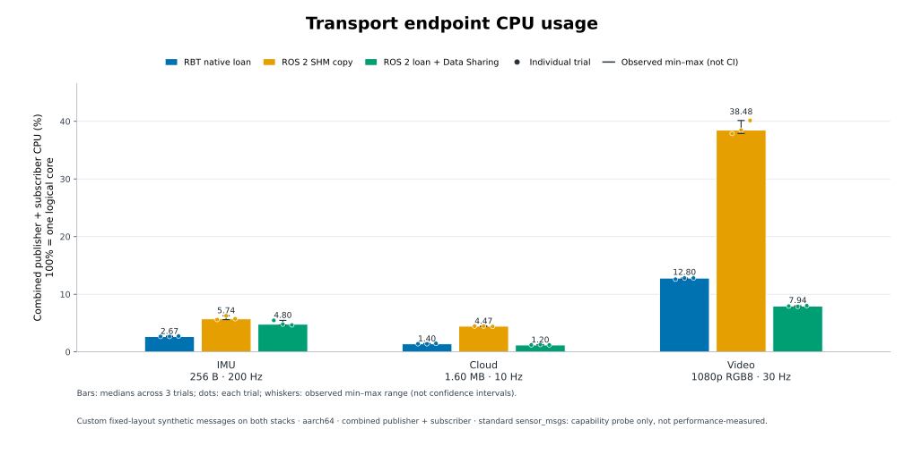
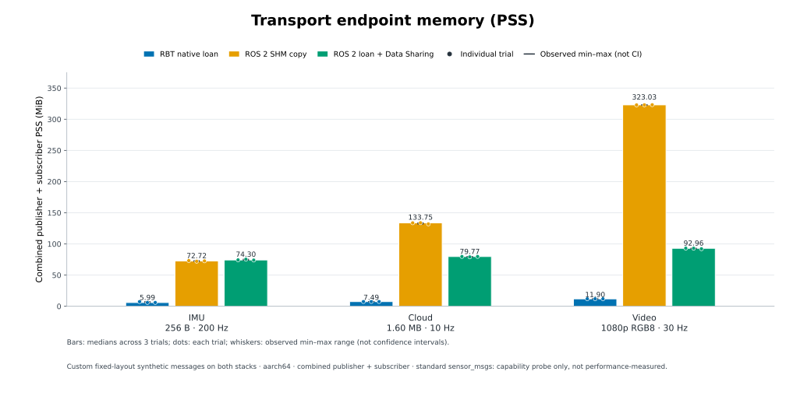

# Raspberry Pi 4 RBT / ROS 2 transport measurements — 2026-11-10

**All 27 formal trials passed.** Each mode reached its target publish and
receive count with 100% delivery and no invalid samples, drops, duplicates,
sequence gaps or regressions. RBT and ROS loan modes passed sampled shared
buffer alias checks in every trial; the copy mode reported no aliases.

This is an additional ARM64 board measurement alongside the
[x86_64 result](../2026-10-29/README.md) and
[QCS8550 result](../2026-10-31-qcs8550/README.md). The board, operating
system, ROS distribution, kernel and background processes differ, so these
reports are not a controlled comparison of processor performance.
The [benchmark protocol](../../README.md) describes the harness modes and
validation rules.

## Environment and workload

| Item | Board configuration |
|---|---|
| Board | Raspberry Pi 4 Model B Rev 1.2 |
| OS / kernel | Ubuntu 26.04 LTS, Linux 7.0.0-1009-raspi, aarch64, glibc 2.43 |
| Memory | 3,869,652 KiB reported RAM; 4,096-byte page size |
| CPU placement | Both endpoints allowed CPUs 2 and 3. A shared cpufreq policy covers CPUs 0–3; governor remained `ondemand`. No isolation, governor or frequency-policy changes were made. |
| RBT SDK | ARM64 SDK 0.8.0 copied unchanged from the AidLux host into an isolated test directory; no relocation was needed. The SDK's recorded build stamp is 2026-10-22 and records GCC 11.4.0. Its runtime source commit is not embedded. |
| ROS | Lyrical; rclcpp 32.0.3; rmw_fastrtps_cpp/shared_cpp 9.4.10; Fast DDS 3.6.2; Fast CDR 2.3.6; sensor_msgs 5.9.3 |
| Build | Native ARM64 GCC 15.2.0, CMake 4.2.3, Release, `--parallel 2`, Python 3.14.4 |
| Measured harness | [`ec20ae3ff3c50c581a892e79a53b0a8c1767b350`](https://github.com/sunwen-me/rbt/tree/ec20ae3ff3c50c581a892e79a53b0a8c1767b350/benchmarks/ros2_transport) |
| Schedule | 3 s warmup + 15 s measurement; three repetitions for each mode and workload; rotated mode order |

Each synthetic message has a 16-byte sequence/timestamp prefix followed by a
fixed 256-byte, 1,600,000-byte or 6,220,800-byte payload at 200 Hz, 10 Hz or
30 Hz, respectively. These resemble IMU-, point-cloud- and uncompressed
1080p RGB8-sized traffic. They are not standard `sensor_msgs` transfers,
video encoding, physical sensors or an end-to-end driver benchmark. Both
publishers fill the payload and both subscribers use the same sparse payload
and sequence checks.

The RBT and ROS benchmark executables were built natively with GCC 15.2. The
reused SDK binaries were not rebuilt. The SDK's four inspected public headers
match this checkout byte for byte, and the copied SDK tree manifest matches
its AidLux source (`eeb4e63e03e2f9ba30a832f26683d1b41d7a685625122f0280bd781357f96004`).
The SDK provenance identifies iceoryx2 fork `0.10.0-rbt.2`, upstream commit
`135d09dd8b29f321f1725920d434864c4e512378`, source-diff SHA-256
`b0e90730fee476487b0c47dba0a272b0d0df9c5480629f8ac64849b8882d91d1`, and
patch-series SHA-256
`1c9a653f7ef7b3d39164ab2d506d99ada52ce2e5525647efa6e978e7307fe1c5`.

RBT used the Sensor stream profile with queue depth 1, no history, two
publisher loans and one subscriber borrow. ROS used best-effort, volatile,
keep-last depth 1 and the benchmark's four-sample pool plus two extra
samples. SHM-copy transport used `maxMessageSize` / segment sizes of
64 KiB / 512 KiB for IMU, 2 MiB / 8 MiB for cloud and 8 MiB / 32 MiB for
video. In ROS loan mode the corresponding values were 64 KiB / 512 KiB for
each case; payloads use Data Sharing while Shared Memory Transport remains
enabled for ROS traffic.

## CPU and memory results

Values are **median [min–max] of three repetitions**. CPU adds publisher and
subscriber; 100% represents one logical core. PSS adds the two endpoint
processes before taking the median of approximately 1 Hz samples. Sampled
peak PSS is the highest combined sample across the three trials, not an
instrumented allocation peak. Summed RSS remains in the CSV and can count
shared mappings more than once. CPU uses `/proc` process ticks over about
14.995 seconds, with 100 ticks/second accounting; memory has 15 one-second
samples per trial. Collector and unrelated background-process CPU/PSS are
excluded from endpoint totals.

| Workload | Path | CPU % | Combined PSS MiB | Sampled peak PSS MiB |
|---|---|---:|---:|---:|
| 256 B IMU-sized, 200 Hz | RBT native loan | 2.67 [2.67–2.73] | 5.99 [5.99–7.37] | 7.37 |
|  | ROS SHM copy | 5.74 [5.60–6.27] | 72.72 [72.12–73.19] | 73.20 |
|  | ROS loan + Data Sharing | 4.80 [4.67–5.47] | 74.30 [74.00–75.42] | 75.42 |
| 1,600,000 B cloud-sized, 10 Hz | RBT native loan | 1.40 [1.40–1.47] | 7.49 [7.49–7.50] | 8.26 |
|  | ROS SHM copy | 4.47 [4.40–4.47] | 133.75 [132.00–133.87] | 133.87 |
|  | ROS loan + Data Sharing | 1.20 [1.20–1.27] | 79.77 [79.13–79.77] | 80.49 |
| 6,220,800 B video-sized, 30 Hz | RBT native loan | 12.80 [12.60–12.80] | 11.90 [11.90–11.90] | 11.90 |
|  | ROS SHM copy | 38.48 [37.88–40.15] | 323.03 [322.84–323.21] | 323.21 |
|  | ROS loan + Data Sharing | 7.94 [7.87–8.00] | 92.96 [92.14–93.06] | 95.80 |

In this configuration RBT used less PSS in all three cases and less CPU than
both ROS paths in the IMU case. ROS loan had slightly lower median CPU for
cloud and materially lower median CPU for video; no single path led every
metric. These results do not attribute memory differences to a specific
allocator or runtime cause.





## Why video CPU is higher than ROS loan

The formal results retain the original default APIs: **RBT 12.80%, ROS loan
7.94% combined CPU**. The SDK and benchmark implementations remain unchanged.
The difference is concentrated in the publisher. Formal video medians are:

| Path | Publisher CPU % | Subscriber CPU % |
|---|---:|---:|
| RBT native loan | 12.47 | 0.33 |
| ROS loan + Data Sharing | 7.14 | 0.80 |

[`FixedPublisher::loan()`](../../../../sdk/cpp/include/rbt/stream.hpp) calls
the native initialized `Publisher::loan()`. The copied SDK's
`include/iceoryx2/v0.10.0/iox2/publisher.hpp` constructs the borrowed payload
with `new (&sample->payload_mut()) Payload();`. For this generated POD
`VideoFrame`, value initialization zeroes all 6,220,816 bytes, including the
16-byte prefix. This default gives callers initialized fields even when they
assign only part of a message.

The benchmark then fully overwrites the payload, sequence and timestamp in
[`fill_message`](../../common.hpp). The measured ARM64 Release executable
still contains the full-frame zeroing call; it was not eliminated by the
compiler. At 30 Hz this adds approximately **186.6 MB/s of logical zero-fill
writes**, before the normal payload fill. This is a byte-count calculation,
not a measurement of DRAM traffic. The
[ROS loan path](../../ros2_endpoint.cpp) borrows through
`rcl_borrow_loaned_message` and then fills the returned payload.

A separate [diagnostic record](video-cpu-diagnosis.json) and
[preload probe source](memset_probe.c) retain the runtime evidence:

- With 1 s warmup and 5 s measurement, each publisher produced 180 frames
  including warmup. RBT performed 180 zero fills of 6,220,816 bytes and 180
  payload fills of 6,220,800 bytes. ROS loan performed 180 payload fills and
  no zero-fill `memset` calls of at least 1 MB.
- An RBT-only comparison used three repetitions per condition with identical
  instrumentation. Its optional diagnostic flag skipped only the RBT
  publisher's exact zero-valued, 6,220,816-byte `memset`; all payload fills
  remained. Median combined CPU fell from **12.21% to 7.01%**. Every trial
  published and received 150 measured samples, with zero detected errors or
  drops and eight shared-buffer alias matches. Original endpoint binary
  hashes were unchanged.

This identifies default payload initialization as the main source of the
extra publisher CPU for this workload. The comparison includes preload and
clock-sampling overhead, counts include warmup, and its 5 s measurement
window is shorter than the formal 15 s window. Both conditions retained the
same CPU affinity and `ondemand` governor. The synthetic skip is diagnostic
evidence only: the published SDK keeps its default initialization behavior,
and the original formal table, CSV, summary and charts are preserved.

Raw diagnostic logs and trial results remain locally under
`output/ros2-transport-benchmark/raspberrypi4-20261110/video-cpu-diagnosis/`
and on the Pi under
`/home/pi/rbt-transport-bench-20261110/video-cpu-diagnosis/`.

## Delivery and zero-copy evidence

Each repetition published and received exactly 3,000 IMU, 150 cloud and 450
video samples. All 27 trials had 100% delivery, zero invalid samples and zero
drops, duplicates, gaps or regressions. RBT and ROS loan modes each had eight
sequence-matched application addresses per trial resolving to the same
shared backing device, inode and exact byte offset in both processes; copy
mode had zero aliases. Native ROS loan counts matched the sent and received
sample counts. Both ROS endpoints reported Shared Memory Transport only;
Data Sharing was OFF in copy mode and ON in loan mode. This is sampled buffer
evidence, not an exhaustive trace of every message.

The separate [standard-message capability probe](standard-loan-probe.jsonl)
reported `publisher_can_loan=false` and `subscriber_can_loan=false` for
`sensor_msgs/Imu`, `sensor_msgs/PointCloud2` and `sensor_msgs/Image`. It does
not publish or receive benchmark samples. Custom fixed-array loan results do
not imply that standard sensor messages use the same path.

## Board telemetry and clock

The passive formal-run monitor recorded 502 samples at one-second intervals
over 501 seconds. The sysfs CPU thermal zone ranged from 38.946 to 43.816 °C;
the shared CPU frequency policy ranged from 600 MHz to 1.5 GHz while the
governor remained `ondemand`. These are sampled ranges and do not establish a
constant clock or temperature during individual trials. Firmware throttle
flags were unavailable because `vcgencmd` could not access `/dev/vcio`, and
no sysfs throttling interface was exposed; this report makes no claim that
throttling did or did not occur.

The board clock was initially reported unsynchronized during setup and
chrony synchronized it automatically. Both formal-run environment snapshots
reported NTP synchronization as `yes`; no manual board-time change was made.
The benchmark measures elapsed time with `CLOCK_MONOTONIC`.

## Retained artifacts and validation

- [Per-trial rows](trials.csv) and [portable summary](summary.json): all 27 trials, counts, rates, CPU/PSS/RSS, latency, alias evidence and build/profile hashes.
- [Environment and provenance](environment.json): before/after snapshots, software versions, page size, SDK provenance and binaries, clock status, and telemetry summary.
- [Full formal telemetry](environment-samples.jsonl): all one-second passive samples.
- [Standard-message capability output](standard-loan-probe.jsonl).
- [CPU charts](cpu-usage.svg) and [PSS charts](memory-pss.svg), with PNG and Chinese-language variants alongside.
- [Video CPU diagnosis](video-cpu-diagnosis.json) and [probe source](memset_probe.c), kept separate from the formal results.

Per-trial raw results, logs, XML profiles, resource samples, process maps
and alias evidence are retained on the Pi at
`/home/pi/rbt-transport-bench-20261110/formal-1/`, and locally at
`output/ros2-transport-benchmark/raspberrypi4-20261110/formal-1/`. The local
artifact directory also retains smoke results, environment snapshots, the
build log (`output/ros2-transport-benchmark/raspberrypi4-20261110/build.log`)
and 23/23 harness unit-test output. The smoke matrix passed 9/9 and the
formal matrix 27/27. ROS Lyrical and build dependencies were installed for
this test; production drivers, services and governor settings were not
changed. No robot motion or hardware-driver acceptance test is claimed.

## Build and reproduce

This benchmark reused the installed ARM64 SDK and ROS 2 Lyrical. The copied
SDK path below was kept isolated from other system installations:

```bash
ROOT=/home/pi/rbt-transport-bench-20261110
SDK_PREFIX="$ROOT/sdk/rbt-sdk-0.8.0-linux-aarch64"
source /opt/ros/lyrical/setup.bash
export RBT_PREFIX="$SDK_PREFIX"
export NATIVE_PREFIX="$SDK_PREFIX"
export CMAKE_PREFIX_PATH="$SDK_PREFIX${CMAKE_PREFIX_PATH:+:$CMAKE_PREFIX_PATH}"
export LD_LIBRARY_PATH="$ROOT/build:$SDK_PREFIX/lib${LD_LIBRARY_PATH:+:$LD_LIBRARY_PATH}"

cmake -S "$ROOT/source" -B "$ROOT/build" \
  -DCMAKE_BUILD_TYPE=Release \
  -DPython3_EXECUTABLE=/usr/bin/python3 \
  -DCMAKE_PREFIX_PATH="$CMAKE_PREFIX_PATH"
cmake --build "$ROOT/build" --parallel 2
python3 "$ROOT/source/run.py" \
  --rbt-executable "$ROOT/build/rbt_transport_bench" \
  --ros-executable "$ROOT/build/ros2_transport_bench" \
  --cpus 2,3 --seconds 15 --warmup 3 --repetitions 3 \
  --output "$ROOT/formal-replay"
```

The output directory must be new. The same SDK/native prefix is needed at
build and runtime; the protocol README documents the Fast DDS profiles and
validation requirements.
