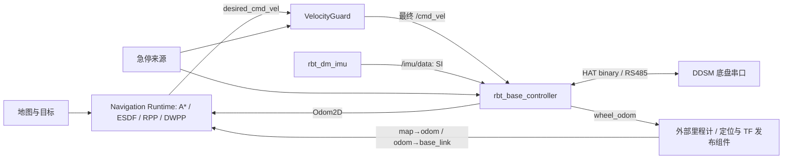

# RBT 底盘与 DM IMU 原生驱动

两个独立可执行程序已实现：`rbt_base_controller` 使用 DDSM 串口协议执行最终速度，`rbt_dm_imu` 解析 DM IMU 串口并发布原生 IMU 消息。它们使用现有 RBT C++ SDK，不依赖 ROS 2。`hardware_messages` 是共享的 IDL 与消息接口包。



底盘不发布 TF。外部组件结合 `odom→base_footprint` 轮式位姿与已知固定外参，向现有导航输入提供 `odom→base_link`；`map→odom` 仍由定位负责。导航算法和消息 ABI 保持不变。

底盘实际读取用户指定的 [current YAML](base_controller/config/ddsm_robot_current.yaml)：轮半径 0.05 m、轮距 0.395 m、方向 +1/-1、100 Hz 控制目标、600 ms 命令流 watchdog。每条最终命令的截止时间独立生效，默认 Guard TTL 100 ms，不延长到 600 ms。串口线程独立于 IPC/遥测循环检查期限、急停与反馈故障。

IMU 输出 rad/s、m/s²、归一化四元数，完整样本三个 CRC 全通过才发布；时间戳是主机接收时间。默认输入单位沿用原 ROS 驱动的 SI 假设，可配置 deg/s、g 转换。后两组 tag、终止字节、设备单位和安装轴向仍需用真实协议或采集验证。

## 工作区构建

先按 [导航构建说明](../navigation/README.md) 构建原生 navigation，安装其消息接口。以下是当前工作区使用的 SDK 和工具链路径；`yaml-cpp` 由系统 CMake 包提供。

```bash
export LD_LIBRARY_PATH="$PWD/target/phase4-toolchain/lib${LD_LIBRARY_PATH:+:$LD_LIBRARY_PATH}"
cmake --install target/navigation-build --prefix "$PWD/target/robot-sdk"

cmake -S drivers/hardware_messages -B target/hardware-messages-build -G Ninja \
  -DCMAKE_CXX_COMPILER="$PWD/target/phase4-toolchain/bin/x86_64-conda-linux-gnu-g++" \
  -DCMAKE_MAKE_PROGRAM="$PWD/target/phase4-toolchain/bin/ninja" \
  -DCMAKE_PREFIX_PATH="$PWD/target/release-build-distribution-20261020/sdk-root" \
  -DCMAKE_INSTALL_PREFIX="$PWD/target/robot-sdk"
cmake --install target/hardware-messages-build

cmake -S drivers/base_controller -B target/base-controller-build -G Ninja \
  -DCMAKE_BUILD_TYPE=Debug \
  -DCMAKE_CXX_COMPILER="$PWD/target/phase4-toolchain/bin/x86_64-conda-linux-gnu-g++" \
  -DCMAKE_MAKE_PROGRAM="$PWD/target/phase4-toolchain/bin/ninja" \
  -DCMAKE_PREFIX_PATH="$PWD/target/robot-sdk;$PWD/target/release-build-distribution-20261020/sdk-root"
cmake --build target/base-controller-build --parallel 3

cmake -S drivers/dm_imu -B target/dm-imu-build -G Ninja \
  -DCMAKE_BUILD_TYPE=Debug \
  -DCMAKE_CXX_COMPILER="$PWD/target/phase4-toolchain/bin/x86_64-conda-linux-gnu-g++" \
  -DCMAKE_MAKE_PROGRAM="$PWD/target/phase4-toolchain/bin/ninja" \
  -DCMAKE_PREFIX_PATH="$PWD/target/robot-sdk;$PWD/target/release-build-distribution-20261020/sdk-root"
cmake --build target/dm-imu-build --parallel 3
```

## 运行与验证

[底盘启动参数](base_controller/README.md)、[IMU 启动参数](dm_imu/README.md)、[消息契约](hardware_messages/README.md) 和 [导航接入契约](../navigation/docs/base-controller-contract.md) 分别记录运行接口。底盘在正常启动时配置电机链路并确认零速；IMU 默认读取既有数据流，`--configure-device` 才发送启动配置，默认不保存设备参数。这里的离线测试不访问 `/dev/ddsm`、`/dev/dm_imu`。

```bash
ctest --test-dir target/base-controller-build --output-on-failure
ctest --test-dir target/dm-imu-build --output-on-failure

cmake -S drivers/tests -B target/hardware-ipc-build -G Ninja \
  -DCMAKE_BUILD_TYPE=Debug \
  -DCMAKE_CXX_COMPILER="$PWD/target/phase4-toolchain/bin/x86_64-conda-linux-gnu-g++" \
  -DCMAKE_MAKE_PROGRAM="$PWD/target/phase4-toolchain/bin/ninja" \
  -DCMAKE_PREFIX_PATH="$PWD/target/robot-sdk;$PWD/target/release-build-distribution-20261020/sdk-root"
cmake --build target/hardware-ipc-build --parallel 3
ctest --test-dir target/hardware-ipc-build --output-on-failure
```

Release 用独立构建目录及 `CMAKE_BUILD_TYPE=Release`。底盘 Sanitizer 配置为 `RBT_BASE_CONTROLLER_SANITIZE=ON`（ASan+UBSan）；IMU 使用 `RBT_DM_IMU_SANITIZERS=address` 或 `undefined`。设置 `ASAN_OPTIONS=detect_leaks=1:halt_on_error=1`、`UBSAN_OPTIONS=halt_on_error=1`。测试结果和文件清单见 [VERIFICATION.md](VERIFICATION.md)。

串口伪终端测试验证软件和协议路径。真实电机、制动、IMU 单位/轴向、桥接固件、车体 footprint、定位和硬件急停尚未在实车验收。
