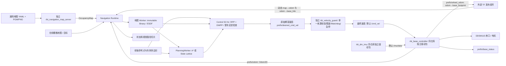

# rbt_navigation

原生二维差速导航最小闭环。核心是纯 C++20：Occupancy/Binary Map、精确 ESDF、保留兼容入口的八邻域 A*、可选的前驱 State Lattice、参考 Nav2 的 Regulated Pure Pursuit（RPP）与解析 Dynamic Window Pure Pursuit（DWPP）、异步 NavigationManager 和独立速度守卫。原生目标复用 RBT SDK 的 iceoryx2 通信和 TF Buffer；编译/运行不需要 ROS 2。

架构、坐标/时间和接口调查见 [architecture.md](docs/architecture.md)，前驱差速的几何与状态格实现边界见 [state-lattice-design.md](docs/state-lattice-design.md) 和 [State Lattice 移植记录](docs/lattice-port.md)，原生 DDSM 底盘的最终速度、安全和遥测接口见 [base-controller-contract.md](docs/base-controller-contract.md)，ROSE 源码依赖与改写清单见 [rose-port.md](docs/rose-port.md)，[Nav2 RPP/DWPP 移植说明](docs/nav2-port.md) 记录控制器来源和差异。验收记录见 [verification.md](docs/verification.md)，所有 navigation 交付文件见 [files.md](docs/files.md)。

MID360 / SuperLIO 的原生接入见 [LIO 架构、协议与部署](docs/lio-integration.md)：可选的原子导航帧提供同帧位姿与点云，独立桥接输出 TF、速度里程计和实时障碍融合地图。下图保留静态地图输入模式；启用 LIO 时使用独立的 static/live 前缀，导航里程计与 TF 都来自桥接，底盘继续消费最终 `/cmd_vel`。

用户PCD/PGM的逐格对齐、真实地图仿真、KISS首次定位构建与雷达上电验收见 [地图与定位联调](docs/map-readiness.md)。

用户确认与实机一致的robot-sim雷达安装、完整坐标链和LIO外参换算见 [雷达安装参考](docs/robot-mount.md)。



原生 `rbt_base_controller` 与 `rbt_dm_imu` 已在同仓库 `drivers/` 独立包中实现；[硬件配置和限制](docs/hardware-sources.md) 记录接口与设备限制。底盘不发布 TF。外部 TF 发布组件组合 `odom→base_footprint` 与固定 `base_footprint→base_link` 外参，向 runtime 发布动态 `odom→base_link`，并提供动态 `map→odom`；runtime 仅订阅这两个动态输入，没有 static-TF subscriber。组合变换保留轮式采样时间。启用前驱几何配置时，runtime 将位姿和目标换算到 `base_footprint` 轮轴参考点；只接受纵向且轴线对齐的 `base_link` 偏移，`Odom2D` 速度仍表示轮轴前向速度与 yaw rate。没有几何配置的旧模式继续使用原来的参考点约定。驱动软件已实现不表示真实设备、单位、轴向、标定、HAT 固件或硬件急停已经验证。

导航的 `BUILD_TESTING` 四进程 IPC 场景仍使用不安装的 `rbt_navigation_base_sim` 和地图/定位 fixture，不启动真实硬件进程。新 hardware-process PTY 场景位于 [drivers/tests](../drivers/tests/)；伪串口测试不代表真实电机或 IMU 已工作。

默认硬件配置以 [ddsm_robot_current.yaml](../drivers/base_controller/config/ddsm_robot_current.yaml) 为准。`rbt_hardware::messages` 提供 `Imu`、`WheelOdometry`、`BaseStatus`，具体时间戳、单位假设、协议未确认字段与来源许可见 [硬件源码接入记录](docs/hardware-sources.md)。

## 构建与测试

安装了 RBT C++ SDK 的环境：

```bash
cmake -S navigation -B target/navigation-build -G Ninja \
  -DCMAKE_BUILD_TYPE=Debug -DCMAKE_PREFIX_PATH=/path/to/rbt-sdk
cmake --build target/navigation-build --parallel 4
ctest --test-dir target/navigation-build --output-on-failure
```

本次工作区实际使用的命令（仓库已有工具链和发布 SDK）：

```bash
cmake -S navigation -B target/navigation-build -G Ninja \
  -DCMAKE_BUILD_TYPE=Debug \
  -DCMAKE_MAKE_PROGRAM="$PWD/target/phase4-toolchain/bin/ninja" \
  -DCMAKE_CXX_COMPILER="$PWD/target/phase4-toolchain/bin/x86_64-conda-linux-gnu-g++" \
  -DCMAKE_PREFIX_PATH="$PWD/target/release-build-distribution-20261020/sdk-root" \
  -DPNG_PNG_INCLUDE_DIR="$PWD/target/map-image-sdk/include" \
  -DPNG_LIBRARY="$PWD/target/map-image-sdk/lib/libpng.so" \
  -DZLIB_INCLUDE_DIR="$PWD/target/phase4-toolchain/include" \
  -DZLIB_LIBRARY="$PWD/target/phase4-toolchain/lib/libz.so"
cmake --build target/navigation-build --parallel 4
export LD_LIBRARY_PATH="$PWD/target/phase4-toolchain/lib${LD_LIBRARY_PATH:+:$LD_LIBRARY_PATH}"
ctest --test-dir target/navigation-build --output-on-failure
```

核心可脱离 RBT SDK 构建，`-DRBT_NAVIGATION_NATIVE=OFF`。默认启用的独立地图文件加载库需要 `yaml-cpp` 和 `libpng`；只构建纯 C++ 核心时另设 `-DRBT_NAVIGATION_MAP_IO=OFF`。核心库和消息接口不链接图像/YAML 库。默认编译 `-Wall -Wextra -Wpedantic -Werror`，测试在 Release 下也保持断言启用。`-DRBT_NAVIGATION_SANITIZER=address` 或 `undefined` 可用于单独构建目录；UBSan 建议设置 `UBSAN_OPTIONS=halt_on_error=1`。

```bash
cmake --install target/navigation-build --prefix "$PWD/target/navigation-guard-install"
```

安装后可 `find_package(rbt_navigation CONFIG REQUIRED)` 并链接 `rbt_navigation::core` 或 `rbt_navigation::native`。

`target/map-image-sdk` 是为本工作区旧 sysroot 构建的 libpng；依赖来源与复现见 [通用地图验收](docs/verification.md#2026-10-22通用栅格地图文件接入)。使用正常系统工具链及已安装的 libpng/zlib 开发包时无需指定上述四个 PNG/ZLIB 路径。

## 通用栅格地图文件

生产地图入口使用常见的 **YAML + PGM/PNG**：YAML 保存分辨率、原点、黑白翻转和占用阈值，图像保存每格数据。独立地图进程加载文件并发布现有 `OccupancyMap`，不需要 ROS 2，也不要求先转换为本项目的 JSON。完整字段、模式和坐标约定见 [map-files.md](docs/map-files.md)。

```bash
target/navigation-build/rbt_navigation_map_server \
  --map /absolute/path/to/map.yaml --prefix rbt/navigation/demo
```

地图进程只读一次文件，以默认 2 Hz 重发同一内容和版本的心跳；停止发布后，导航仍按现有地图超时规则停车。更换地图后重启该进程，使用新的递增版本。每个 prefix 只运行一个地图来源。地图进程不提供定位或 TF；外部定位与里程计仍须提供下文规定的输入。

随包 [maps/simulation_obstacle.yaml](maps/simulation_obstacle.yaml) 和 PGM 是之前仿真地图的通用格式示例，仍为合成测试场景。可用五进程闭环验证文件加载路径，此时 fixture 不再发布地图：

```bash
python3 navigation/scripts/native_integration.py \
  --build-dir target/navigation-build --scenario obstacle \
  --map-file navigation/maps/simulation_obstacle.yaml \
  --output-dir target/navigation-file-map-evidence
```

`--scenario map_dropout` 配合相同 `--map-file` 检查地图进程崩溃后的过期停车。C++ 文件消费者可通过 `find_package(rbt_navigation CONFIG REQUIRED COMPONENTS map_io)` 和 `rbt_navigation::map_io` 使用加载库；不请求该组件的现有消息消费者无需寻找 PNG/YAML 依赖。

## 运行仿真

快速算法闭环和故障注入（虚拟单调时间、独立安全状态对象）：

```bash
target/navigation-build/rbt_navigation_sim
```

原生 IPC 四进程演示/验收（导航、安全速度守卫、测试用模拟底盘、地图与定位 fixture）：

```bash
python3 navigation/scripts/native_integration.py \
  --build-dir target/navigation-build --output-dir target/navigation-ipc-evidence
```

可用 `--scenario success`、`obstacle`、`cancel`、`dropout`、`watchdog`、`estop`、`guard_crash`、`expired`、`authority`、`cmd_vel`、`base_expired` 单独运行。默认 `--controller rpp-dwpp`，可设 `--controller rpp` 对照。故障场景只向本次脚本启动的子进程注入故障；脚本清理自己启动的进程，保存 stdout/stderr 和 JSON 结果。该模拟器只验证软件 IPC 契约和独立 watchdog，不验证真实电机、制动能力或硬件急停。

测试构建中也可以在四个终端手工运行模拟系统（Ctrl-C 停止）：

```bash
target/navigation-build/rbt_navigation_base_sim --config navigation/config/demo.conf
target/navigation-build/rbt_velocity_guard --config navigation/config/demo.conf
target/navigation-build/rbt_navigation_runtime --config navigation/config/demo.conf
target/navigation-build/rbt_navigation_native_fixture --config navigation/config/demo.conf --scenario success
```

`rbt_navigation_base_sim` 只连接差速运动学模拟适配器，拥有自己的最终命令验证器、超时停车和急停路径，启动日志明确标为 SIMULATOR。它仅在 `BUILD_TESTING=ON` 时构建并且不安装。真实硬件进程 `rbt_base_controller` 位于 `drivers/base_controller`；启动参数和消息契约见 [底盘接口说明](docs/base-controller-contract.md)。

## 前驱差速底盘 State Lattice

[front-drive-navigation.conf](config/front-drive-navigation.conf) 显式选择原生 C++ State Lattice，并加载 robot-sim 底盘与轮组的八点 footprint。runtime 默认提供随包的多边形几何，因此使用 Lattice 时无需显式设置 `--robot-geometry`；只需提供 `--lattice-file` 并保持多边形模式。显式选择 `circle` 不支持 Lattice。配置中的资源路径相对该配置文件解析；地图分辨率必须与原语文件的 0.05 m 一致。缺少原语文件会报错，不会改用 A*。已有 `astar` 选择继续保留。

部署时提供各自环境中的 prefix 和 TF authority：

```bash
target/navigation-build/rbt_navigation_runtime \
  --config navigation/config/front-drive-navigation.conf \
  --prefix rbt/navigation/front-drive \
  --tf-map <MAP_AUTHORITY_UUID> --tf-odom <ODOM_AUTHORITY_UUID>
```

runtime 内部以驱动轮轴为状态与目标参考点；输入 TF、入站目标和对外路径仍使用 `base_link`。速度命令是轮轴的前向速度和 yaw rate。当前几何适配支持纵向、同向的 `base_link` 偏移，例如配置中的 0.196 m。规划与控制共用多边形足迹及中间运动检查。算法范围、源代码边界见 [State Lattice 设计与实现](docs/state-lattice-design.md) 和 [移植记录](docs/lattice-port.md)，消息契约、文件清单和真实测试结果见 [前驱验收记录](docs/lattice-verification.md)。

局部跟踪实验增加可选的 `--controller vector-pursuit` 与 `--controller vector-pursuit-window`；默认继续使用 `rpp-dwpp`。这两个模式将 Vector Pursuit 几何核接入已有 RBT 路径分段、速度调节和整车碰撞框架，并非完整复现上游 ROS 2 插件。[实验记录](docs/vector-pursuit-experiment.md) 说明相同固定路径下的四组对比、假设响应模型及结果。

前驱原生 IPC 仿真保留转弯、0.60 m 通道倒车和扫尾反例三个场景，默认启用 RPP+DWPP；整车轨迹另用独立 SAT 判定。脚本使用随机隔离的速度主题，不连接物理 `/cmd_vel`。

```bash
python3 navigation/scripts/lattice_integration.py \
  --build-dir target/navigation-build --scenario all \
  --output-dir target/navigation-lattice-evidence
target/navigation-video-tools/bin/python navigation/scripts/render_lattice.py \
  --evidence target/navigation-lattice-evidence/tail_sweep \
  --output-dir output/navigation-lattice/demo
```

渲染只读取录制的路径、底盘状态和结果，输出图、MP4 及带源文件哈希的 metadata；`--png-only` 可仅生成总览图。

## 录制仿真视频

可选的被动记录器订阅实际 RBT 地图、路径、底盘状态与导航状态，不发布控制命令。下面的工具运行原有四进程 obstacle 场景，采集消息后生成 1× 播放的二维视频；轨迹直接取实际采样点，不插值或替换控制器。绘图依赖只安装在独立 venv，不参与导航编译和运行。

```bash
cmake --build target/navigation-build --target rbt_navigation_telemetry_recorder --parallel 4
python3 -m venv target/navigation-video-tools
target/navigation-video-tools/bin/python -m pip install matplotlib pillow imageio-ffmpeg
target/navigation-video-tools/bin/python navigation/scripts/simulation_video.py \
  --build-dir target/navigation-build --output-dir output/navigation-simulation
```

输出包括 `obstacle.mp4`、`preview.gif`、`capture/telemetry.csv`、`capture/path.csv`、`capture/map.json` 和本次 IPC 运行日志。`--render-only` 可从同一份采样数据重新编码。视频记录器仅在测试构建中提供，不安装到生产前缀。

## 复杂 PGM 场景

[complex_scenarios.json](maps/complex_scenarios.json) 提供多房间穿门和仓库货架绕行两张 12 × 8 m、0.1 m/格的地图。配置文件指定地图、起点、目标和超时；通用 fixture 从同一 YAML 加载碰撞检查地图，不自行发布地图。实际链路为地图服务器、导航、Guard、模拟底盘、外部 TF/目标 fixture 与只读记录器六个独立进程。A*、RPP/DWPP、0.18 m 物理半径和 0.10 m 规划净距均沿用现有实现。

```bash
target/navigation-video-tools/bin/python navigation/scripts/complex_simulation.py \
  --build-dir target/navigation-build --scenario all \
  --output-dir output/navigation-complex --speed 2
```

`--scenario rooms` 或 `warehouse` 单独运行；`--no-render` 只执行原生 IPC 与采样验收，无需绘图库。`--render-only` 从已经通过的每个场景结果和采样重新生成 `navigation.mp4`、`preview.gif`、`overview.png`。播放速度明确标注；位姿和速度直接选取最近的实际采样点，没有轨迹插值。记录器只保存首条非空 A* 路径，图例也明确标为初始路径。

复杂场景测试通过以下命令运行，每个场景最多 120 s：

```bash
ctest --test-dir target/navigation-build -R '^navigation_ipc_complex_' --output-on-failure
```

地图可用 `python3 navigation/scripts/generate_complex_maps.py` 确定性再生成。地图特征见 [maps/README.md](maps/README.md)，实际运行指标与证据见 [验收记录](docs/verification.md#2026-10-22复杂-pgm-地图仿真)。这些场景验证二维静态地图导航，不包含动态障碍物或真实传感器建图。

## RBT 原生接口边界

`types/navigation.rbt` 是规范源，`generated/` 由现有 `rbt-idl` 生成，不手写 ABI/布局散列：

```bash
target/debug/rbt-idl generate navigation/types/navigation.rbt \
  --rust navigation/generated/rust --cpp navigation/generated/cpp \
  --descriptor navigation/generated/descriptors
```

navigation 的地图、Odom、目标、状态和路径主题使用 `--prefix` 加下表后缀；最终 `/cmd_vel` 默认是全局 topic，硬件 IMU 默认使用 `/imu/data`。RBT Sensor stream 的有界替换语义适用于最新数据；没有消息持久化。地图必须周期性重发同版本相同内容作为心跳，目标发送方重试到状态确认；幂等目标不会重复重启规划。

| 后缀 | 类型 | 语义 |
|---|---|---|
| `map` | OccupancyMap 切片 | map 坐标、-1 未知/0..100 占据、行优先、原点为角点，支持 yaw；最多 1,000,000 格 |
| `odom` | Odom2D | 底盘或 LIO 桥接提供驱动轮轴参考点的前向速度和 yaw rate；启用几何配置时支持纵向、同向的 `base_link` 偏移；每个导航前缀只选一个来源，采样时间对应 `odom`→`base_link` TF |
| `goal` | GoalCommand | operation=0 设置 / 1 取消；id=0 仅用于取消当前任务；新目标 id 必须递增，相同当前 id/内容幂等，旧 id/冲突内容拒绝 |
| `status` | NavigationStatus | 状态、错误码、目标 id 和地图版本；枚举在 core/types.hpp |
| `path` | PlannedPath 切片 | map 位姿序列，用于路径可视化/调试；地图版本与目标 id；最多 100,000 点，空切片表示路径已撤回 |
| `desired_cmd_vel` | VelocityCommand | 导航原始期望速度；默认位于 `prefix` 下，来源 1，HostMonotonic stamp、同钟域 valid_until、v/ω |
| `/cmd_vel` | VelocityCommand | 守卫输出的最终速度；默认是全局绝对主题，来源 100。测试显式覆盖为 `/<prefix>/cmd_vel` 以隔离多组运行 |
| `estop` | EmergencyStop | 独立配置的 estop-source、递增序列和新鲜时间，active=1 锁定急停，0 解除；解除后需要新速度命令 |
| `guard_state` | GuardState | 可选守卫诊断：时间戳、序列、允许的原始来源、输出来源、拒绝计数、Watchdog 和急停标志；不作为底盘安全心跳 |
| `base_state` | BaseState | 仅测试模拟底盘反馈，含位姿、速度、拒绝计数、Watchdog 和急停状态 |
| `wheel_odom` | `rbt.hardware::WheelOdometry` | 底盘的新鲜轮反馈、积分位姿、RPM 与 `odom` / `base_footprint` frame；由 `rbt_hardware::messages` 定义 |
| `base_status` | `rbt.hardware::BaseStatus` | 底盘拒绝计数、I/O fault、watchdog、急停、电机命令与反馈新鲜度诊断 |
| `/imu/data` | `rbt.hardware::Imu` | DM IMU 默认 topic；HostMonotonic 主机收包时间，rad/s 与 m/s² 输出，实际 wire 单位待设备确认 |

`--tf-map UUID` 和 `--tf-odom UUID` 指定两个现有 Dynamic TF 发布 authority；导航直接通过两个 `DynamicTfSubscriber` 填入现有 `TransformBuffer`，在 Odom 采样时刻查询 `T_map<-base_link`。runtime 没有 static-TF subscriber。外部 TF 发布组件须根据 wheel odometry 的 `odom→base_footprint` 与固定 `base_footprint→base_link` 外参组合出动态 `odom→base_link`，同时发布动态 `map→odom`，并保留 wheel odometry 的采样时间。runtime 默认加载随包的 `config/front-drive-geometry.yaml`；先查可执行文件旁的构建配置目录，再查安装前缀下的 `share/rbt_navigation/config`，不依赖当前工作目录。`--robot-geometry YAML` 可显式覆盖；配置文件中的相对路径相对配置文件目录解析，命令行值覆盖配置值。通用圆形测试 fixture 可显式使用 `--robot-geometry circle` 保留旧参考点和半径行为；关闭 `RBT_NAVIGATION_MAP_IO` 时，原生 runtime 也要求显式选择 `circle`。ready 日志会显示实际几何文件或 `circle` 以及 footprint 点数。启用 YAML 几何时，runtime 把查询到的 `base_link` 位姿和输入 `base_link` 目标换算到轮轴内部坐标，发布路径时再换回 `base_link`；当前仅接受纵向、同向的偏移。`Odom2D` 的 `linear_x` 与 `angular_z` 按轮轴前向速度和 yaw rate 使用。短 Odom 队列允许 TF 流到达顺序差异，超过输入时限的任何样本不再使用；查询失败不退回无限旧位姿。保留 RBT 默认 TF 精度策略：时间不确定度必须已知、合成后不超过 1 ms。模拟源声明的是合成时间精度，不代表真实传感器精度。输入端点尚未存在时由循环重试连接，输出零速度，不要求各进程的启动顺序。

wire Stamp 包含 RBT HostClock 的完整 48 字节 source identity、generation、kind 与纳秒。跨主机、不同启动/时间命名空间、设备时钟或未知时钟直接拒绝；接入设备时钟数据前应由外部 RBT 时间映射转换到相同 HostMonotonic。领域层 TimePoint 只是适配边界已校验后的纳秒。

## 行为和限制

控制默认 50 Hz，地图 Worker 默认 10 Hz，规划由事件触发；频率和超时可通过配置/同名 `--key value` 参数覆盖。`max-linear`、`max-angular`、`robot-radius` 和 `planning-clearance` 可调；其他控制器参数可以通过纯 C++ 配置结构注入。runtime 默认使用随包的多边形几何；A* 规划以该足迹的外接圆半径作为机器人半径，跟踪碰撞检查使用多边形足迹。只有显式设置 `--robot-geometry circle` 才使用 0.18 m 圆形 fixture。前驱 State Lattice 也使用多边形足迹，并在规划与控制时共用足迹碰撞检查器。地图同版本内容变化被拒绝。地图版本变化撤回旧路径并重规划；新目标抢占/取消通过 generation 使迟到规划结果失效。

| 当前状态 | 事件 | 结果 |
|---|---|---|
| Idle / 终态 | 有效新目标 | Planning |
| Planning / Replanning | 搜索成功 | Controlling |
| Controlling | 地图变化、偏离或预测碰撞 | Replanning（恢复次数有界） |
| 活动状态 | 新目标 / 匹配取消 | Planning / Canceled |
| 活动状态 | 缺图、过期输入、定位丢失、插件异常、超时 | Failed，输出零 |
| Controlling | 到达位置与最终朝向 | Succeeded，输出零 |
| 终态 | 相同目标重试 | 保持终态；开始新任务需要更大的 id |

首版是软件 MVP，尚未进行真实机器人验收。没有实测定位、LiDAR 建图、动态障碍跟踪、轨迹优化、复杂恢复或 Hybrid A*。圆形 footprint 与距离场查询偏保守，窄通道可能拒绝。地图更新是整图重建；大图/长路径尚未做实时性能保证。规划插件必须合作响应 stop_token；非合作插件不会阻塞控制调用，但会拖延进程析构。静态接口注入不提供动态插件加载器。

导航发布的原始命令只由独立 `rbt_velocity_guard` 消费；守卫不是底盘驱动，不连接硬件或 TF。同仓库独立驱动包中的原生 `rbt_base_controller` 已订阅最终流、验证期限并通过自己的 100 Hz 目标周期串口线程执行速度与超时停车。守卫来源号校验不提供密码学身份认证、动态租约或仲裁；部署仍需用 RBT capability/进程权限限制最终主题的发布者，并保留独立硬件急停。SDK `ControlCommand` 只有序列和值，不能替代本包双轴速度 wire 接口。`SafeBase` 头文件名是兼容别名；新代码使用 `VelocityGuard`，旧核心测试保持可编译。

测试模拟底盘只发布 Odom 和 BaseState，不发布 TF；发布失败时丢弃并限频记录计数，继续验证最终命令和执行安全 tick。外部 fixture 使用 BaseState 原始采样时间发布测试用 TF。生产 DDSM 底盘发布 `WheelOdometry`、`Odom2D` 和 `BaseStatus`，不发布 TF；动态 TF 由外部 TF 发布组件负责。真实设备和急停链的验收状态由根工作区最终记录维护。
