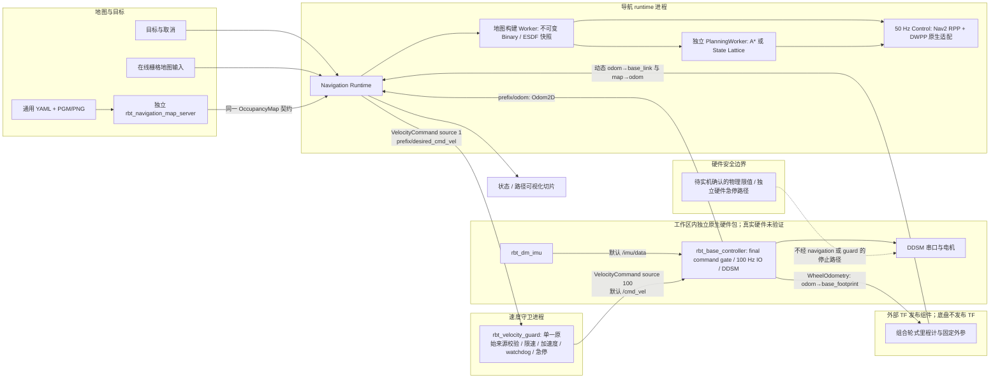
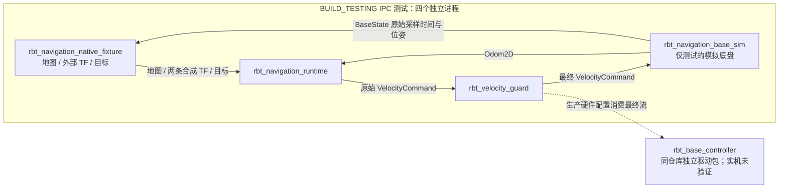

# RBT 原生差速导航：调查与实施记录

2026-10-27 新增的 MID360 / SuperLIO 接入架构、原子消息、时间约定和实时障碍融合见 [lio-integration.md](lio-integration.md)。下文保留既有静态地图与底盘解耦的调查记录。

## Milestone 1：架构调查（2026-10-21）

本次只扩展 `navigation/`，不修改既有未提交工作。项目没有根 CMake；C++ SDK 与驱动是独立 CMake 消费包。

| 能力 | 真实接口 / 结论 |
|---|---|
| 原生通信 | `sdk/cpp/include/rbt/stream.hpp`：`FixedPublisher/Subscriber<T>`、`SlicePublisher/Subscriber<Header,Element>`，loan/send/receive，使用 IDL 生成的 ABI 描述 |
| 组件与生命周期 | `runtime.hpp`：Component、ActivationContext、ComponentRuntime；`effect_scope.hpp` 管理 jthread 与关闭动作 |
| 任务/RPC | `rpc.hpp` 提供原生 RPC 和取消；导航 MVP 使用幂等目标/取消消息与状态反馈，无需新增任务框架 |
| 调度 | `wait.hpp` 提供 readiness/WaitSet；未发现独立 C++ 周期 Timer/Executor，采用局部受控线程和 steady deadline 周期循环 |
| TF | `transforms.hpp`：TransformBuffer::lookup_at；`tf_transport.hpp`：DynamicTfSubscriber::open/drain，直接复用 |
| 时钟 | `time.hpp`：HostClock::create/now_monotonic，完整 ClockIdentity 含启动/时间命名空间身份；接收边界必须匹配 |
| 定位与里程计 | 同仓库独立驱动包中的 `rbt_base_controller` 发布新鲜反馈生成的 `WheelOdometry` 与导航 `Odom2D`；它不发布 TF。外部 TF 发布组件组合 `odom→base_footprint` 与固定外参，发布动态 `odom→base_link` 和 `map→odom`；runtime 只接收这两条动态输入，没有 static-TF subscriber。前驱几何配置将 TF 位姿换算到轮轴参考点；两帧仅沿 x 偏置且 yaw 相同，前向速度和 yaw rate 数值相同 |
| 传感器/地图 | `types/sensor.rbt` 有 Image/PointCloud，没有 LaserScan/OccupancyGrid；navigation 接收地图切片、不实现 LiDAR 建图。同仓库独立驱动包中的 `rbt_dm_imu` 与 `rbt_hardware::messages` 提供原生 IMU wire，但输入单位与轴向仍待真实设备确认 |
| 底盘/权限 | `types/control.rbt` 只有 sequence/value，不能表示差速 v/ω。navigation wire 定义原始/最终 `VelocityCommand`；`drivers/base_controller` 中的原生 `rbt_base_controller` 复用 message-only 目标，并独立验证最终命令、期限、watchdog 和急停；真实电机与硬件急停尚未验证 |
| 配置/插件/日志 | 各包独立配置和进程日志；没有公共 C++ 动态插件注册器。首版用纯虚算法接口和静态注入，不创建通用插件生态 |
| 构建/测试 | 沿用 `find_package(rbt CONFIG REQUIRED)`、`rbt::runtime`/`rbt::iox2`、CTest；navigation 核心可单独构建，无中间件头文件依赖。hardware messages、base、IMU 是同仓库独立包；drivers 的 PTY 测试不是实车验收 |

## 设计与实施顺序

IPC 测试拓扑是四个进程，测试模拟底盘替代上图中的生产底盘。生产包与测试替身在图中分开标示：

测试底盘不发布 TF。fixture 提供地图/目标及 `map→odom`、`odom→base_link` 两条动态合成 TF；后者从新收到的 BaseState 提取原始采样时间与位姿，不对旧反馈重打时间戳。测试模拟底盘只通过差速运动学适配器更新模拟状态，拥有自己的最终命令来源/时间/序列/数值验证、watchdog 和急停处理，输出 Odom2D 与 BaseState。该可执行文件仅在 `BUILD_TESTING` 构建且不安装。四进程合成测试不会启动同仓库独立驱动包中的原生 DDSM 或 IMU 进程。生产外部 TF 发布组件从 `WheelOdometry` 的 `odom→base_footprint` 与固定 `base_footprint→base_link` 外参组合动态 `odom→base_link`，连同动态 `map→odom` 输入 runtime，并保留轮式采样时间。runtime 只开两个动态 TF authority，没有 static-TF subscriber；前驱几何配置允许两帧存在已知的纵向偏置，runtime 将位姿换算到轮轴参考点，前向速度与 yaw rate 数值保持相同；不支持横向或 yaw 偏置。硬件几何和调度采用用户指定的 current YAML，见 [硬件接入记录](hardware-sources.md)。

M2 数据模型与接口 → M3 地图转换/Binary/ESDF → M4 A* → M5 RPP + DWPP → M6 异步管理器与原生适配 → M7 独立速度守卫与外部底盘契约 → M8 算法仿真与跨进程测试。A*/ESDF/RPP/DWPP/NavigationManager 算法文件未因安全进程拆分而改变。`safe_base.hpp` 保留 `SafeBase` 兼容别名；新实现入口为 `safety/velocity_guard.hpp`，模拟底盘 API 位于 `simulation/simulated_base.hpp`。

2026-10-21 用户修正 M5：以固定版本 Nav2 RPP 为参考，加入官方解析 DWPP（默认启用）；保留纯 C++ 接口、现有地图查询和独立速度守卫/底盘进程边界。具体移植边界与许可见 nav2-port.md。

算法域 `TimePoint` 是由调用方选定时钟的非负纳秒值。原生适配器仅接受与本进程 RBT HostClock 完全相同的身份后转换；仿真独立注入时间，不与原生时间混用。map 是全局平面规划坐标，odom 连续，base_link 的 x 前向/y 左向。位姿和路径在 map。加载前驱几何配置时，内部规划/跟踪位姿与 footprint 以驱动轮轴中点为参考，线速度沿该点的车体 x 轴，角速度绕 z；外部 TF、目标及发布路径保持 base_link 位姿语义。地图行优先、原点为左下角，栅格中心偏移半格，支持原点 yaw。

通用文件地图通过独立 `rbt_navigation_map_server` 接入：`map_io` 负责 YAML 与 PGM/PNG 解码，翻转图像行并生成已有 OccupancyGrid；地图进程发布已有 OccupancyMap，不改 IDL、MapWorker、A*、ESDF 或控制器。图像/YAML 依赖留在可选 `map_io` 组件，现有核心和消息接口保持原依赖。地图版本在启动时从 HostClock 生成，静态内容心跳只刷新发布时间，不能解释为传感器新测量。文件地图的五进程测试禁用 fixture 自带的地图发布，单独检查绕障闭环和地图进程崩溃后的地图过期停车。字段与限制见 [map-files.md](map-files.md)。

未知和地图外视为障碍；地图、TF、Odom 过期/未来时间均停止。地图构建后只发布 shared_ptr<const GridMap>；规划保留版本，地图变更停止旧路径并重规划。规划在隔离 jthread 中运行，控制不等待搜索。取消/抢占增加 generation，使迟到规划结果失效。生产速度流由独立 `rbt_velocity_guard` 和同仓库独立驱动包中的 `rbt_base_controller` 分别验证；底盘不依赖导航主 IPC，并按自己的命令 deadline 和 watchdog 停车。软件 watchdog 不替代硬件急停。驱动软件已实现，真实电机/IMU与硬件急停仍未验收。完整 wire 字段、topic、默认时限和生产集成检查项见 [base-controller-contract.md](base-controller-contract.md) 与 [hardware-sources.md](hardware-sources.md)。

2026-10-28 新增前驱底盘配置与 State Lattice 入口，共用整车多边形和旋转扫掠查询；保留 A* 默认兼容入口、RPP/DWPP、Manager 和独立安全进程。原语来源、原生适配范围及未移植的 Smac 能力见 [lattice-port.md](lattice-port.md)，配置与参考点见 [state-lattice-design.md](state-lattice-design.md)。未更改 wire 字段或底盘驱动参数。
