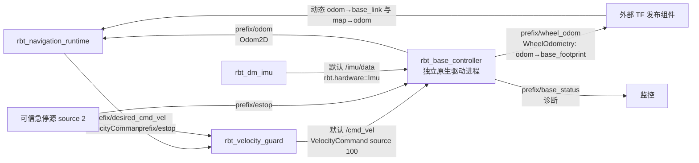

# 原生底盘控制器接口与安全边界

原生 DDSM 控制器进程 `rbt_base_controller` 已作为同仓库独立驱动包放在 [drivers/base_controller](../../drivers/base_controller/)；硬件 telemetry 类型由 [rbt_hardware::messages](../../drivers/hardware_messages/) 导出。IMU 进程在 [drivers/dm_imu](../../drivers/dm_imu/)。驱动软件已经实现，真实电机、IMU、设备单位、轴向、标定和急停硬件尚未验证。



底盘复用现有导航 wire 的 `VelocityCommand`、`EmergencyStop`、`Odom2D`，通过 `rbt_navigation::messages` 消息目标接入；硬件 telemetry 通过 `rbt_hardware::messages` 接入。它不链接导航算法，也不发布 TF。**TF 由外部 TF 发布组件提供**：它根据 `WheelOdometry` 的 `odom→base_footprint` 和已知固定 `base_footprint→base_link` 外参，组合并发布动态 `odom→base_link`，同时发布动态 `map→odom`。组合时保留 wheel odometry 的采样时间戳。runtime 只有 `--tf-map` 与 `--tf-odom` 两个动态 TF 输入，没有 static-TF subscriber；它在 `Odom2D` 采样时刻查询既有 `map→base_link` 变换。加载前驱几何配置后，runtime 将该位姿换算到轮轴中点 `base_footprint`；目标和对外路径仍采用 `base_link` 位姿。当前模型两帧 yaw 相同、仅沿 x 偏置 -0.196 m，所以两帧的前向速度相同，可直接使用轮式 `Odom2D` 的前向速度和 yaw rate。带横向偏置或 yaw 偏置的几何配置暂不支持。

## Topics 与消息

| Topic | 发布者 → 消费者 | 内容与约束 |
|---|---|---|
| `prefix/desired_cmd_vel` | runtime → guard | 原始期望速度，`VelocityCommand.source_id=1` |
| `/cmd_vel` | guard → base controller | 默认全局最终速度 topic，`source_id=100`；base 独立校验 |
| `prefix/estop` | 可信急停源 → guard 与 base controller | 默认 `source_id=2`；递增序列、HostMonotonic stamp 和 active=0/1 |
| `prefix/guard_state` | guard → 诊断订阅者（可选） | 允许来源、输出来源、拒绝计数、watchdog 与急停标志；不参与底盘安全控制 |
| `prefix/wheel_odom` | base controller → telemetry/定位 | 新鲜且有效的一对轮反馈产生的位姿、机体速度、左右 RPM；frame `odom`，child `base_footprint` |
| `prefix/odom` | base controller → navigation runtime | 既有 `rbt.navwire::Odom2D`，采样时间与轮速反馈对应 |
| `prefix/base_status` | base controller → 诊断订阅者 | 拒绝计数、I/O 失败、watchdog、急停、I/O fault、反馈新鲜度和左右电机命令 |
| `/imu/data` | `rbt_dm_imu` → base controller | `rbt.hardware::Imu`；配置可覆盖 topic，默认 frame `imu_link` |

`prefix` 默认 `rbt/navigation/demo`。base controller 的最终速度 topic 默认字面量 `/cmd_vel`，可用 `--cmd-vel-topic` 覆盖。四进程 navigation IPC 测试显式使用 `/<prefix>/cmd_vel` 来隔离场景；这是测试覆盖值，生产默认仍为全局 `/cmd_vel`。IMU topic 由 DM IMU 配置与 base controller 配置保持一致。`BaseStatus` 是诊断数据，不续期命令、不替代设备安全路径。

两种 `VelocityCommand` 流沿用 `navigation/types/navigation.rbt` 的同一个 ABI，不改变字段布局：

| 字段 | IDL 类型 | 消费端语义 |
|---|---|---|
| `stamp` | `Stamp` | 生成时刻；包含 48 字节 HostMonotonic `source_id`、`generation:u64`、`nanoseconds:i64`、`kind:u32` 与 `reserved:u32=0` |
| `source_id` | `u64` | 命令来源号，与 `Stamp.source_id` 的时钟身份不同；原始流默认 1，最终流默认 100 |
| `sequence` | `u64` | 非零且严格递增；拒绝的命令不能更新序列或续期 |
| `valid_until_ns` | `i64` | 同一 HostMonotonic 域内的绝对截止时间，到达即失效 |
| `linear_x` | `f64` | 差速驱动轮轴中点的机体前向速度，单位 m/s，必须有限；正值向前。前驱配置下两帧 x 轴平行、仅沿 x 偏置，数值也等于 base_link 前向速度 |
| `angular_z` | `f64` | 车体绕 z 轴角速度，单位 rad/s，必须有限；正值逆时针 |

底盘拒绝时钟身份不匹配、来源错误、重放、过期、TTL 超限、非有限或超出本地限值的命令。SDK `ControlCommand` 只有序列和值，不能表达这组双轴速度接口。

安装原生 SDK 后，底盘的 CMake 依赖保持在消息层：

```cmake
find_package(rbt_navigation CONFIG REQUIRED)
find_package(rbt_hardware CONFIG REQUIRED)

target_link_libraries(rbt_base_controller PRIVATE
    rbt_navigation::messages
    rbt_hardware::messages)
```

其中 `rbt_navigation::messages` 仅导出生成的 navigation wire 与 RBT stream 依赖；`rbt_hardware::messages` 导出 `rbt/hardware.hpp` 和 HostClock/stream 小型适配。底盘不依赖 `rbt_navigation::core` 或 `rbt_navigation::native`，不复制 wire 布局，也不包含 TF 发布器。

## 驱动周期与失效处理

底盘自己的串口 I/O/control 线程以 100 Hz 为周期目标。每个周期读取本地命令 gate、计算差速电机命令并交换左右轮反馈；HAT 反馈等待有 25 ms 上限，可能超过 10 ms 周期，因此实际频率可能低于目标。即使 guard 或 main IPC 接收循环停止推进，线程也会按已接收命令的期限把目标设为零并继续安全 tick。当前 DDSM 配置的 command watchdog 为 600 ms，但每个最终命令的 TTL 上限是 250 ms，且 `valid_until_ns` 先到就先停车；600 ms watchdog 不延长命令 TTL。默认 guard 输出 TTL 是 100 ms、guard 输入 watchdog 是 250 ms。反馈年龄超过 50 ms 时立即停止电机输出；桥接器错误或电机错误也立即进入 I/O fault。其他连续 I/O 失败达到 5 次后锁存 fault。`BaseStatus.watchdog_expired` 供诊断。

原始命令来源 `1`、guard 输出来源 `100`、急停来源 `2` 默认各自不同且非零。底盘要求只从受保护的最终 topic 接收来源 100。source 字段不作密码学身份认证，部署还需使用 RBT capability 和进程权限限定 raw 与最终 topic 的发布者。急停消息由 guard 与底盘分别接收，锁存后立即清零；解除后需要新的速度命令。软件接收路径不能替代直接到驱动/硬件安全链的急停路径。

DDSM 非错误类连续 I/O 失败达到配置阈值后进入 I/O fault 并清除活动速度；桥接器错误或电机错误不等待阈值，立即触发 fault。连续 5 个健康反馈周期后 fault 可解除，但故障状态变化会清除当前命令，因此必须收到一条新的有效速度命令才会恢复运动。正常关闭时 I/O 线程会尝试发送停止命令；进程被强杀、USB 断开、HAT 固件失效或电机不响应时无法保证再发送软件零速，因此必须保留独立硬件停车保护。

## 当前 DDSM 与 IMU 配置

底盘以 [ddsm_robot_current.yaml](../../drivers/base_controller/config/ddsm_robot_current.yaml) 为准：DDSM115，默认 HAT 二进制链路 `/dev/ddsm` / 460800 baud，电机 ID 1/2、方向 +1/-1，轮半径 0.05 m、轮距 0.395 m，100 Hz，反馈期限 50 ms，I/O 失败/恢复各 5 次，电机命令限值 330，角速度 PID `1/0/0` 和输出限幅 0.5，IMU 超时 0.5 s 且不使用 IMU 姿态。Frame 是 `odom` / `base_footprint`。自动整定参数只是配置，不会在启动时执行。硬件驱动默认速度限制为 0.7 m/s 与 1.8 rad/s；这些上限不代表实车可安全达到。

IMU 输出采用 ROS 2 `sensor_msgs/Imu` 的消息单位：角速度 rad/s、加速度 m/s²、归一化四元数 x/y/z/w，协方差为零表示未知。但 DM 设备参考源码并未说明角速度和加速度 wire 单位；当前输入默认值是 rad/s 与 m/s² 的显式假设，配置允许 `deg/s`、`g` 转换，必须通过设备协议或实测确认。轴按传感器原样输出，不含轴向重映射或标定；外部静态外参负责安装朝向。

完整 DDSM 配置来源、IMU 帧布局、未确认字段及许可来源见 [hardware-sources.md](hardware-sources.md)。HAT 二进制桥接固件未包含在工作区，不能用原厂 JSON 固件替代；当前软件接入不证明其桥接可用或真实底盘行为正确。

导航原有四进程合成测试继续使用 `rbt_navigation_base_sim`，不改成真实底盘。新增 [drivers/tests](../../drivers/tests/) 的 hardware-process PTY 测试通过伪终端提供串口响应，不代表真实电机或 IMU 测试。本文件不报告测试通过，也不声称硬件工作正常；测试状态和证据由根工作区最终验收记录维护。
