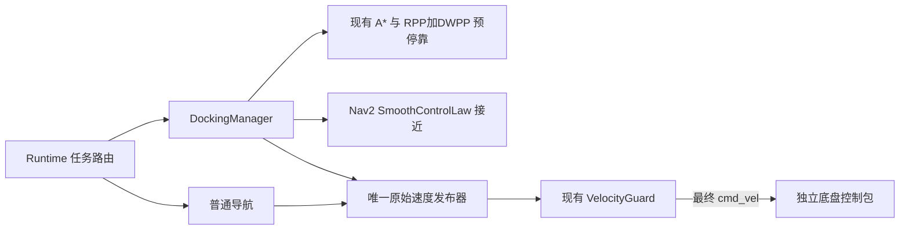

# RBT 固定位姿停靠方案

日期：2026-10-28。本文是设计方案，尚未实现。首版范围为固定 map 中最终 base_link 位姿的非充电停靠。

方案以 Nav2 Jazzy `opennav_docking` 与 `nav2_graceful_controller` 源码 SHA `426682ff88405a99617294f5cc8401a61aa5fa50` 为基线，保留 RBT 已有的 A*/ESDF/RPP/DWPP、NavManager、TF、单一原始速度出口、独立 Guard，以及底盘自身 watchdog 急停。只移植所需数学与任务流程，不引入 ROS 2 构建或运行依赖。

前驱差速车体的轮轴参考点、Lattice 预停靠规划与 footprint 接入见 [State Lattice 方案](state-lattice-design.md)。按用户确认，footprint 仅含底盘与轮组，不考虑机械臂；该几何适配不改变本文的 Nav2 停靠成功判据和任务流程。

## 1. Nav2 源码基线

| 源码 | 本方案采用的行为 |
| --- | --- |
| [docking_server.cpp](https://github.com/ros-navigation/navigation2/blob/426682ff88405a99617294f5cc8401a61aa5fa50/nav2_docking/opennav_docking/src/docking_server.cpp) | 预停靠、固定系目标获取、控制目标外推、接近控制、取消、失败后 resetApproach 与有限重试 |
| [simple_non_charging_dock.cpp](https://github.com/ros-navigation/navigation2/blob/426682ff88405a99617294f5cc8401a61aa5fa50/nav2_docking/opennav_docking/src/simple_non_charging_dock.cpp) | 固定目标模式、staging 参数与跳过预停靠导航策略；默认 isDocked 只比较 XY 距离 |
| [controller.cpp](https://github.com/ros-navigation/navigation2/blob/426682ff88405a99617294f5cc8401a61aa5fa50/nav2_docking/opennav_docking/src/controller.cpp) | SmoothControlLaw 调用、轨迹预测与可配置的碰撞检查 |
| [smooth_control_law.cpp](https://github.com/ros-navigation/navigation2/blob/426682ff88405a99617294f5cc8401a61aa5fa50/nav2_graceful_controller/src/smooth_control_law.cpp) 与 [ego_polar_coords.hpp](https://github.com/ros-navigation/navigation2/blob/426682ff88405a99617294f5cc8401a61aa5fa50/nav2_graceful_controller/include/nav2_graceful_controller/ego_polar_coords.hpp) | 极坐标与 SmoothControlLaw 的原始计算、减速和速度限制 |

移植的数学代码保留 Nav2 原 Apache-2.0 版权声明、许可证和来源记录，并标注本地改动。仅适配纯 C++ 类型和数学 API，不链接 ROS 2 包。

## 2. 任务流程与坐标

任务顺序沿用官方流程：导航到 staging，或按官方 `navigate_to_staging_pose` 与 `dock_prestaging_tolerance` 逻辑跳过导航；在预停靠后把固定 map 目标转换并获取到固定系 odom；循环执行接近控制；每轮先用原始目标调用 `isDocked`；成功即请求零速度并结束。可重试的接近失败按官方 `resetApproach` 返回 staging，再按 `max_retries` 有限重试；重试耗尽或恢复失败时立即请求零速度并报告失败。取消也立即请求零速度并报告结果；以上终态均不等待实测停稳确认。

`resetApproach` 返回 staging 时继续沿用官方 `getCommandToPose` 的 `undock_linear_tolerance=0.05 m` 与 `undock_angular_tolerance=0.05 rad` 判定和 `!dock_backwards` 方向设置。这些条件只用于恢复到 staging，不是最终停靠成功条件。

目标是 map 中的最终 base_link 平面位姿。首版不使用外部目标检测或充电状态。固定坐标系默认 `odom`，map 到 odom 的变换沿现有 TF 查询路径处理；变换异常与超时沿对应错误路径反馈。

SimpleNonChargingDock 的 staging 默认参数为 `staging_x_offset=-0.7 m`、`staging_yaw_offset=0`、`dock_prestaging_tolerance=0.5`。沿用官方 staging 生成与跳过策略，不另加 staging 位置、yaw 或通道验收条件。`dock_backwards` 保留官方配置行为，默认 false；首版不新增禁止倒车限制。

接近循环区分停车目标和控制目标：`isDocked` 检查原始 dock pose。未成功时，控制器将该目标沿其 yaw 方向外推 0.25 m，再变换到 base_link，作为 SmoothControlLaw 与轨迹预测使用的控制目标。该外推用于保持官方接近控制行为，不改变最终成功目标，也不作为新配置项。

## 3. 成功判定与控制

SimpleNonChargingDock 默认 `docking_threshold=0.05 m`；首版按官方默认逻辑，以机器人与原始目标的 XY 距离小于该阈值判定成功。yaw 参与 SmoothControlLaw，但不增加为成功条件；不叠加速度、持续时间、map 二次误差、GuardState 或 BaseStatus 健康门槛。

保持官方 SmoothControlLaw 的极坐标与计算顺序。曲率 κ 为 `-1/r * (k_delta * (delta - atan(-k_phi * phi)) + (1 + k_phi / (1 + (k_phi * phi)^2)) * sin(delta))`。线速度先计算 `v_max / (1 + beta * |κ|^lambda)`，再与 `v_max * (r / slowdown_radius)` 取小值，并钳位到 `[v_min, v_max]`；角速度由 `κ * v` 计算并钳位到 `[-v_angular_max, v_angular_max]`，角速度被钳位时按官方实现回算线速度。倒车模式下的方向、姿态与符号处理沿用官方实现。

每轮先用原始目标检查 `isDocked`，再计算控制量。达到 XY 阈值时直接成功并请求零速度，不计算含 `1/r` 的控制量，也不进入自创的近零对齐或停车状态。基础数值处理只避免不合法运算，不改变有效输入下的官方输出行为。

控制器的碰撞检查沿用 Nav2 可配置行为并接入 RBT 地图查询：`use_collision_detection=true`、`dock_collision_threshold=0.3 m`、`projection_time=5 s`、`simulation_time_step=0.1 s`。阈值判断使用传入的控制目标，也就是已外推 0.25 m 的目标；不得将它描述成围绕原始停车目标的固定免责区域。保留官方终点附近跳过检查的逻辑，不强制覆盖终点，也不额外增加完整制动距离、旋转扫掠或其他拒绝条件。

## 4. RBT 接入边界

| 现有能力 | 接入边界 |
| --- | --- |
| A*、ESDF、RPP、DWPP 与 [NavigationManager](../include/rbt_navigation/runtime/navigation_manager.hpp) | 继续负责 staging 导航；Dock 只组合现有导航能力与终端控制 |
| [导航协议](../types/navigation.rbt)、[runtime_main.cpp](../src/runtime_main.cpp) | 保留普通导航协议与唯一原始速度发布出口 |
| [TF 与 native 适配](../src/native.cpp) | 复用现有 TF 查询路径 |
| [VelocityGuard](../include/rbt_navigation/safety/velocity_guard.hpp) 与[底盘契约](base-controller-contract.md) | Guard 和底盘自身安全职责保持原样；底盘 watchdog 急停继续独立生效 |
| [硬件消息](../../drivers/hardware_messages/types/hardware.rbt) | 不作为 Dock 成功条件，不要求 Dock 消费 BaseStatus 或 WheelOdometry |

RBT 路由继续保证唯一活动任务。任务切换时串行取消当前任务并请求零速度，再处理新任务；不新增 Busy、必须显式取消或等待实测停稳的准入协议。普通 nav 的内部语义不变，既有目标幂等、TTL 和旧规划结果失效规则继续沿用。这些是 RBT 路由规则，不是 Nav2 提供的 API。

Dock 通过独立 NavigationManager 实例组合预停靠导航，与普通导航共享不可变地图快照；内部预停靠目标 ID 与外部导航目标 ID 分开。核心新增 `docking/docking_manager.hpp` 和 `docking/precision_controller.hpp` 及对应实现，现有 `runtime_main.cpp` 负责消息与速度路由，`native.cpp` 适配 odom 固定系查询。CMake、IDL 生成绑定及现有 native fixture/runner 补充对应入口和测试。

## 5. 参数起点

以下取 Nav2 Jazzy 默认值作为起点，保留 `docking.yaml` 配置入口，后续按实测调整。参数起点不代表实机精度保证。

| 参数 | 起点 |
| --- | ---: |
| controller_frequency | 50 Hz |
| v_linear_min / v_linear_max | 0.1 / 0.25 m/s |
| v_angular_max | 0.75 rad/s |
| slowdown_radius | 0.25 m |
| max_retries | 3 |
| dock_approach_timeout | 30 s |
| fixed_frame | odom |
| staging_x_offset / staging_yaw_offset | -0.7 m / 0 |
| dock_prestaging_tolerance | 0.5 |
| docking_threshold | 0.05 m |
| 控制目标外推 | 0.25 m（沿目标 yaw，固定源码行为） |

## 6. 任务反馈

拟新增 DockStatusV1，仅反馈 `stamp`、`sequence`、`goal_id`、`phase`、`error`、`retry_count` 等任务信息。可选误差只用于诊断，不参与成功判定。阶段描述预停靠、接近与终态即可，不拆出独立的对齐、驻留或等待阶段。

拟新增 `prefix/dock_goal`，复用既有 GoalCommand 的开始/取消、目标位姿与 timeout 字段；位姿隐含为 map 中最终 base_link 位姿。`prefix/dock_status` 使用新 DockStatusV1。普通 `prefix/goal`、`prefix/status` 保持原用途；普通导航与 Dock 共用已有 `prefix/desired_cmd_vel` 的发布器、来源号与序列。最终 `/cmd_vel` 继续由 Guard 发布，旧消息布局保持原样。

不要求 Dock 消费 GuardState、BaseStatus 或 WheelOdometry，不新增依赖这些输入的成功门槛或错误码。已有 Guard、底盘、急停及其安全行为仍留在原层。Dock 请求反馈沿用 RBT 已有任务路由所需语义；不得把 RBT 路由细节描述为 Nav2 API。

## 7. 验收计划

单元与仿真覆盖：

- `isDocked` 的 XY 阈值语义（严格小于）、边界行为，以及 yaw 噪声和速度噪声不会额外阻止阈值内成功。
- 极坐标符号与正反向控制输出、速度限幅、slowdown 与 `v_min` 钳位；控制目标沿目标 yaw 正确外推 0.25 m，且不替代原始成功目标。
- 进入阈值时先成功，不计算导致 `1/r` 的控制量；阈值边界不被额外条件卡住。
- staging 导航及官方跳过路径、接近成功、取消立即请求零速度、失败后 resetApproach、有限重试、耗尽重试与 TF 异常路径；resetApproach 保留 `.05 m / .05 rad` 返回 staging 容差及官方方向设置。
- 官方配置下的碰撞预测与终点附近跳过逻辑，不添加新硬门槛场景。

继续覆盖已有安全崩溃、TTL、estop、controlauthority 与 Debug、Release、ASan、UBSan IPC 回归。测试保持上述官方语义，不新增成功或拒绝门槛。

## 8. 后续范围

P1 可增加轻量感知目标提供器，负责把观测转换为首版固定 base_link 目标契约；P2 再由机械臂或上层任务提供操作位姿。两者均属未来范围，不扩大首版停靠流程或接口依赖。
