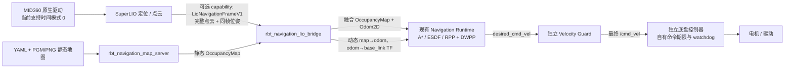

# SuperLIO / MID360 导航接入

本文说明可选的 LIO 导航帧接入契约。它把一帧点云、同帧位姿、速度和 `map→odom` 变换作为一个原子样本交给现有导航；当前导航算法与速度安全链保持原有接口。



## Wire 与时间

`navigation/types/navigation.rbt` 是 wire 规范源；新增的 `LioNavigationFrame` 是由头部 `LioFrameHeader` 与 XYZI 点切片组成的原子消息，通过可选的 `LioNavigationFrameV1` capability 发布。现有 9 个消息 descriptor 保持原布局，新增第 10 个 descriptor；应继续用仓库的 `rbt-idl generate` 命令生成 C++、Rust 和 descriptor 文件，不手改生成 ABI。新增导航帧不改变现有 LIO 通用输出。

导航帧时间戳必须是带完整 identity 的 HostMonotonic 时间。当前 MID360 支持路径只接受其 mode 0 的 `CLOCK_REALTIME` 主机收包时间，并由 `LioReceiptClock` / SDK `ClockMapping` 映射到识别出的 HostMonotonic 域。它表示主机收到数据的时间，不表示硬件采集时刻，且不估计 UDP、内核队列或传感器延迟。映射假设 realtime slew 不超过 500 ppm；观测到墙钟偏移突变、采样间隔超过 200 ms 或映射失效时会关闭输出。无法被观测到的墙钟跳变也无法由该映射识别。MID360 mode 1 和 2 不具备本路径需要的校准，必须拒绝，不能伪造时钟转换。

帧还必须带递增序号、有效定位标志、`world_frame=odom`、`base_frame=base_link` 或 `base_footprint`，以及有限值的位姿、速度和点。Bridge 默认只接受不超过 250 ms 的帧、250 μs 以内的不确定度和最多 200,000 个点。它拒绝缺少有效 `map→odom` 标志、过期/未来帧、重复时间、错误 frame、超出上述界限的样本；不会以单位变换替代缺失定位。

时基相关读数的前后夹取窗口最多 200 μs；单次超限只拒绝该测量与当次转换，不刷新最后有效校准。下一次有效测量仍须通过相对上次有效校准的 200 ms 间隔与墙钟跳变检查，否则锁定停发直到重新激活。这既保留误差上限，也避免调度抖动造成永久停发。

| 字段 | 契约 |
|---|---|
| `stamp / sequence / uncertainty_ns` | 完整 HostMonotonic identity、递增采样序号、已知的收包时基映射误差界；重发不能刷新原始采样时间 |
| `flags / reserved` | bit 0 表示新鲜且有效的先验定位；其他位和 reserved 必须为 0。未定位帧允许由 LIO 发布用于观察，但桥接拒绝用于运动 |
| `odom_base_* / map_odom_*` | 分别为 `odom←base` 和 `map←odom`；位置单位 m，四元数顺序 xyzw，必须归一化 |
| `sensor_origin / LioPoint[]` | 同一估计时刻、odom 坐标的雷达原点和去畸变 XYZI 当前帧；不是累积地图 |
| `linear_velocity / angular_velocity` | 消息 base_frame 的机体系，m/s、rad/s；发布端包含 IMU 到车体原点的速度杆臂项，桥接继续组合 base_link 安装外参 |

旧版裸 `LioOdometry` / `LioWorldCloud` 保留；它们缺少完整时钟身份且点云无 frame，因此桥接要求上述新增能力，不把旧消息直接重新盖上当前时间。

新增帧在平面模式下仅将车体姿态约束为 yaw，车体原点 z 保留由 IMU 位姿和 YAML 安装外参计算出的高度，与点云和雷达原点共用 odom 高度基准。不能沿用旧里程计把车体 z 固定为 `base_z` 的做法，否则低矮障碍会按错误高度被过滤；旧里程计的既有行为保持原样。回归测试覆盖 0.735 m 安装高度、非零 map 高度变换和 0.20 m 障碍。

## Bridge 与静态地图

`rbt_navigation_lio_bridge` 是一个 `ComponentRuntime` 组件，要求 `lio_frame` capability；默认期望 provider id 为 `super-lio`。它发布现有 `prefix/odom`、`prefix/map`，并以两个不同的 TF publisher UUID 分别发布动态 `map→odom` 与 `odom→base_link`。导航 runtime 的 `--prefix` 与两个 TF subscriber UUID 必须对应 bridge 的输出。静态地图 prefix 必须与 bridge 输出 prefix 不同。原始静态 YAML/PGM 地图由独立 `rbt_navigation_map_server` 发布到 `static-prefix/map`；bridge 只在地图样本有效且默认时间戳年龄不超过 2 s 时融合和发布地图。

点云坐标按 `odom` 解释，并用同帧 `map→odom` 投到 `map` 后融合。ObstacleLayer 可配置高度带、机身自过滤半径和量程：CLI 为 `--obstacle-min-height`、`--obstacle-max-height`、`--obstacle-self-radius`、`--obstacle-max-range`；默认值分别是 0.10 m、1.5 m、0.18 m、10 m，点数上限为 200,000。高度相对 map 中底盘高度判断。输入 `base_frame=base_footprint` 时，`--base-x/y/z/yaw` 定义 `base_footprint→base_link` 外参（默认 identity）；机身过滤半径不能大于实测车体，否则会屏蔽贴近车体的外部障碍。实际安装高度、此外参和高度带仍需现场确认。

动态占据只叠加到静态已知空闲格。只有当前帧同一高度带内的有效 ray 实际穿过静态空闲格时，才会清除该格的持久动态占据；没有 TTL 清除，静态障碍与未知格不会被 ray 清掉。Bridge 仅收到新鲜有效 LIO 帧时才发布 Odom，因此帧过期或停止会让导航现有输入过期逻辑停车。融合地图时间戳取静态地图和扫描时间戳的较早者，不取 bridge 的接收/发布心跳时间。融合版本只在地图内容变化时递增；动态杂物频繁变化会反复触发全局重规划，控制可能多次停车等待规划，这是当前整图版本契约的限制。

可按以下参数关系启动：

```bash
target/navigation-build/rbt_navigation_map_server \
  --map /absolute/path/to/static-map.yaml --prefix rbt/navigation/static

target/navigation-build/rbt_navigation_lio_bridge \
  --provider super-lio \
  --prefix rbt/navigation/live \
  --static-prefix rbt/navigation/static \
  --tf-map <unique-map-tf-uuid> --tf-odom <different-odom-tf-uuid>
```

Bridge 也支持严格 `key=value` 的 `--config FILE`；完整 CLI 还包括 `--max-frame-age-ms`、`--static-map-age-ms`、`--base-x/y/z/yaw` 和四个 `--obstacle-*` 参数。上述两个 TF UUID 要同时配置到导航 runtime 的 `--tf-map`、`--tf-odom`；它们必须不同。LIO provider 必须提供预期 id 的 capability。使用真实地图前，先确认地图 frame/origin、安装外参和 LIO 定位对齐；未知空间在现有导航中是障碍。

示例运行配置见 `config/lio-bridge.conf` 与 `config/lio-navigation.conf`。后者以 0.18 m 车体和 0.30 m 额外全局规划余量验证离散 A* 拐角的 RPP 曲线跟踪；余量过小的持续障碍场景曾安全停车但未到达目标，失败记录保留在验收证据中。这些是合成场景的参数，不是实测车体尺寸或制动保证。底盘继续独立检查最终 `/cmd_vel` 的来源、序号、有效期和急停，并保留自身超时停车；不需要由底盘发布 TF。底盘轮速里程计应使用独立输入前缀，避免与桥接输出的导航 `odom` 同主题竞争。

当前链路按 AidLux 同机原生 IPC 部署；导航帧的 HostMonotonic identity 必须与导航、Guard 所在主机相同。跨主机时间转换不在本次适配范围，不能直接转发另一台机器的单调时间戳。

## 当前地图与运行边界

从用户提供的 `jetson-map-review.zip` 提取的同源 PCD 与栅格文件、哈希见[地图 manifest](../../output/navigation-lio/maps/manifest.json)。原始 `obstacle-mask.pgm` 对应 `11_project_z030_200.pgm`，分辨率0.05 m、原点 `[-8.35, -6.25, 0]`、269×179格。用户确认原未知格属于转换程序问题，要求作为白色自由格；已生成当前导航入口 [navigation-map.yaml](../../output/navigation-lio/maps/navigation-map.yaml)：40,171格由205改为255，7,980个障碍格不变，未知格为0。原图保留，坐标与阈值不变，原生地图加载和发布验证通过。PCD地面基准、安装外参与实时先验定位仍待实机确认。

此接入保留导航 runtime 的 A*/ESDF/RPP/DWPP、Guard、最终 `/cmd_vel` 与独立底盘 watchdog。软件 watchdog 与 Guard 不能替代物理急停；真实 MID360/SuperLIO 时间、外参和定位、底盘制动及硬件急停仍需设备侧确认。该链路不要求 ROS 2 runtime。


当前同源地图与定位初始化的后续完善、真实测试结果和上电命令见 [map-readiness.md](map-readiness.md)。首次先验定位须使用KISS已启用的新独立构建；早期review配置的配置检查不代表定位初始化通过。
