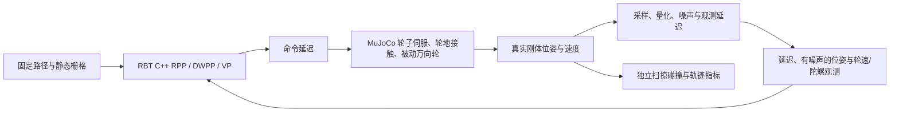

# 轮地物理与延迟观测下的 Pursuit 对比（2026-10-28）

本轮把原来的单车运动学积分替换为 MuJoCo 3.17 的自由刚体、轮子关节、有限力矩速度伺服及地面接触。控制器继续调用已有 RBT C++ 实现，RPP + DWPP 默认配置未切换，真实底盘、消息、Guard、Dock 和导航算法未修改。这仍是包含未辨识参数的仿真实验，尚未建立实机数字孪生。

## 参考与实现边界

参考 [Gazebo Wheel Slip](https://gazebosim.org/api/sim/10/wheel_slip_systems.html) 的逐轮摩擦/滑移建模方式，使用 [MuJoCo 接触模型](https://mujoco.readthedocs.io/en/stable/modeling.html#contact-parameters) 和 [有限力矩速度伺服](https://mujoco.readthedocs.io/en/stable/XMLreference.html#actuator-velocity)。研究记录见 [research.json](../../output/navigation-vp-physics/reference/research.json)。没有复制这些项目的控制算法代码，也没有引入 ROS 2 依赖。



物理闭环使用实验专用 stdin/stdout 桥调用原控制器，四种模式共享原有调速、路径分段及碰撞预测。VP 仍是几何核接入公共 RBT 调速框架；本轮没有比较完整上游 VP 插件的独立速度策略。NavigationManager、原生 TF、LIO、VelocityGuard 与真实驱动没有串入这个物理闭环；既有原生跨进程链路另做回归。

## 模型来源与假设

只读检查了 `192.168.1.153:/home/sw/robot-sim`，没有启动该机器上的仿真或运动节点。原始模型快照见 [robot-mount](robot-mount.md)，本轮获取的控制配置与哈希见 [robot-sim 证据](../../output/navigation-vp-physics/reference/robot-sim/provenance.json)。机械臂的质量和碰撞均不纳入本轮。

| 参数 | 本轮值 | 依据 |
| --- | --- | --- |
| 非机械臂总质量 | 12.0900856 kg | 源模型各 link 惯量合成 |
| 驱动轮半径、宽度 | 0.05035 / 0.0655 m | 源碰撞网格外形 |
| 轮胎接触中心间距 | 0.38550 m | 网格与关节变换合成 |
| 驱动轮/万向轮滑动摩擦 | 1.0 / 0.2 | 源 Gazebo 配置，MuJoCo 中使用显式接触优先级 |
| 速度伺服增益、最大力矩 | 按下表变化 | 未实机辨识的试验假设 |
| 每个驱动关节的电机反射惯量 | 0.001 kg·m² | 未辨识假设，单独检查步长收敛 |
| 胎面接触、万向轮偏距 | 圆冠椭球近似、20 mm | 未测量的接触几何假设 |
| 物理步长 / 控制周期 | 2 / 20 ms | 实验设置 |

源 ROS 仿真的轮距配置为 `0.320 × 3.9 = 1.248 m`，其注释明确用于补偿 Gazebo 转弯滑移。这是另一套仿真的调节值，未用于本轮速度到轮速的换算。本轮按 0.38550 m 几何轮距换算，实际轮半径扰动不会被适配器提前补偿。

预检发现源 CAD 的平胎接触和零万向轮偏距，在本轮假设的力矩限制下几乎不能转弯。相同 0.5 rad/s、5 s 指令，源接触近似只转 0.00137 rad；圆冠胎与 20 mm 偏距近似转 2.422 rad，末端角速度 0.4902 rad/s。接触模型预检见 [记录](../../output/navigation-vp-physics/verification/contact-model-calibration.json)。这些检查说明所选模型能响应指令，并不证明接触参数已匹配实机。

初轮 180 次试验还暴露了轻载车轮在有限力矩伺服下的步长敏感抖动，因此没有把它直接作为最终算法排名。参照 [MuJoCo 电机反射惯量](https://mujoco.readthedocs.io/en/stable/XMLreference.html#body-joint-armature) 加入显式的 0.001 kg·m² 假设后，在 2/1/0.5 ms 步长的低摩擦及轮径扰动预检中，轮速不再反向抖动；4 s 末端位置差小于 0.2 mm。见 [步长问题](../../output/navigation-vp-physics/verification/slippery-step-convergence.json)、[反射惯量验证](../../output/navigation-vp-physics/verification/rotor-inertia-prototype.json)。初轮 [数据](../../output/navigation-vp-physics/main/summary.json) 与 [对应源码](../../output/navigation-vp-physics/reference/prototype-v1/) 保留；最终数据使用 `main-v2/`。

20 mm 偏距改变了万向轮扫掠空间，因此通过 [prepare_geometry.py](../experiments/pursuit_physics/prepare_geometry.py) 生成仅供实验使用的完整轮廓；包含源底盘与万向轮全转向包络，不改 [生产底盘配置](../config/front-drive-geometry.yaml)。新包络下原扫尾夹具无路径，实验障碍从栅格 `[112,120]` 移至 `[111,120]` 后重新规划，保留原夹具默认值。五类公共路径均通过新轮廓的姿态及中间运动检查；原失败日志也保留。

## 公共条件与观测

五类场景为 S 弯、窄弯、前进/倒车换向、旋转后平移和车尾扫掠。每类使用同一条冻结路径、同一地图和扰动起点，四种控制器分别运行三种常规物理/观测设置、种子 0/1/2，共 180 次；另有 60 次驱动轮卸载压力试验，总计 240 次。公共参数为线速度 0.20 m/s、角速度 0.50 rad/s、线加减速度 0.8 m/s²、角加减速度 2.5 rad/s²；没有分别为控制器调参。无噪声 physics 组的三种子是确定性重复核验，不增加独立证据量。

| 设置 | 命令延迟 | 位姿更新 / 延迟 | XY / yaw 噪声标准差 | 摩擦 / 左右轮半径比例 | 伺服增益 / 力矩上限 |
| --- | --- | --- | --- | --- | --- |
| physics | 20 ms | 50 Hz / 0 | 0 / 0 | 1.0 / 1, 1 | 0.4 / 0.6 Nm |
| delayed | 80 ms | 10 Hz / 60 ms | 5 mm / 0.01 rad | 1.0 / 1, 1 | 0.3 / 0.45 Nm |
| slippery | 120 ms | 10 Hz / 100 ms | 10 mm / 0.02 rad | 0.25 / 1, 1 | 0.3 / 0.45 Nm |
| wheel_fault（另列） | 同 slippery | 同 slippery | 同 slippery | 0.25 / 1.01, 0.99 | 0.3 / 0.45 Nm |

wheel_fault 用刚性四点支撑、左右轮径差制造驱动轮卸载故障。模型没有实测轮胎弹性，所以不能把这一组当作“实机轮胎磨损 1% 就会这样”的预测；其结果与常规组分开解释。

另外加入固定随机位姿偏差，delayed 为 XY 2 mm、yaw 0.003 rad 标准差，slippery 为 5 mm、0.01 rad。轮速量化步长 0.01 rad/s，里程计线速度由轮速计算；后两组陀螺角速度噪声标准差为 0.003 rad/s。同种子使用独立、可重复的共同噪声序列，观测时间戳保留原采样时刻。这里是定位误差代理，未模拟点云、遮挡或实际 LIO 算法；静态地图本身仍准确。

导航到达门槛沿用 0.08 m、0.06 rad 和已有近零速度条件。实验另记录控制器上报到达、真实位置/朝向达标、实际余速达标三个维度；没有增加生产控制器的到达条件。初始静置 1 s，到达后固定观察 3 s 并保存上报时、1 s、3 s 快照，任务时间停在上报时刻。1 s 的初步试跑余速结果保留于 [pilot-s-curve-v2](../../output/navigation-vp-physics/pilot-s-curve-v2/summary.json)。

实际轮地接触每 2 ms 检查，独立二维整车扫掠采样位移尺度不大于 2.5 mm，并检查地图边界。预测碰撞导致控制器停止、物理接触、独立扫掠碰撞、倾翻、超时和实验工具错误分别记录。移动 RMS 只统计真实线速度绝对值大于 0.01 m/s 的样本；另有包含原地旋转的全时段朝向 RMS。

## 复现

实验依赖单独安装，导航 C++ 核心和生产运行时不依赖 MuJoCo。

```bash
python3 -m venv target/navigation-physics-tools
target/navigation-physics-tools/bin/pip install -r navigation/experiments/pursuit_physics/requirements.txt
cmake --build target/navigation-lio-release --target rbt_navigation_pursuit_physics_bridge rbt_navigation_pursuit_benchmark -j2

target/navigation-physics-tools/bin/python navigation/experiments/pursuit_physics/prepare_geometry.py \
  --source navigation/config/front-drive-geometry.yaml \
  --output target/pursuit-physics-replay/geometry.yaml

# 使用新的输出目录，避免覆盖已留存的实验。
LD_LIBRARY_PATH=target/phase4-toolchain/lib:target/map-image-sdk/lib \
target/navigation-lio-release/rbt_navigation_pursuit_benchmark \
  --geometry target/pursuit-physics-replay/geometry.yaml \
  --lattice navigation/config/lattice/diff-5cm-0_5m.json \
  --tail-obstacle-cell-x 111 --output target/pursuit-physics-replay/fixtures

LD_LIBRARY_PATH=target/phase4-toolchain/lib:target/map-image-sdk/lib \
target/navigation-physics-tools/bin/python navigation/scripts/pursuit_physics_benchmark.py \
  --summary target/pursuit-physics-replay/fixtures/summary.json \
  --bridge target/navigation-lio-release/rbt_navigation_pursuit_physics_bridge \
  --geometry target/pursuit-physics-replay/geometry.yaml \
  --output target/pursuit-physics-replay/main --seeds 0,1,2 \
  --profile physics --profile delayed --profile slippery --profile wheel_fault
```
