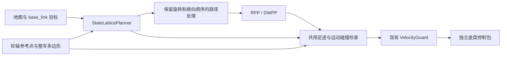

# 前驱差速底盘的 State Lattice 与整车碰撞

日期：2026-10-28。实现与验收记录见 [lattice-verification.md](lattice-verification.md)。本文描述当前代码边界。

## 规划器范围

`StateLatticePlanner` 是纯 C++ 的 `IGlobalPlanner` 实现，可由现有 `NavigationManager` 调用。现有 `AStarPlanner` 保留兼容。Lattice 使用官方 Nav2 Jazzy 提交 `426682ff88405a99617294f5cc8401a61aa5fa50` 的 `nav2_smac_planner` State Lattice 搜索结构与 diff 原语格式；精确源代码边界见 [lattice-port.md](lattice-port.md)。

随包原语集为 5 cm 网格、0.5 m 转弯半径、16 个朝向和 112 条轨迹。搜索状态包含栅格位置、朝向、转弯方向与倒车状态；实现自有 A* 开放表与欧几里得距离启发式。开启 `allow-reverse` 时展开倒车动作。到达搜索容差附近后，局部精确目标连接依次检查旋转、直线移动和末端旋转。

实现范围是 Nav2 State Lattice 搜索结构的原生 C++ 子集，其中没有 OMPL analytic expansion、平滑器或启发式缓存。选择 `smac-lattice` 时，几何 YAML 和 lattice JSON 都必须可加载；缺失时 runtime 报错，不会静默回退到 A*。

## 车体参考点与共用碰撞检查

[front-drive-geometry.yaml](../config/front-drive-geometry.yaml) 对应 robot-sim 的底盘、驱动轮和后万向轮组件，不包含机械臂。`base_footprint` 位于驱动轮轴中点；`drive_to_base` 为 `[-0.196, 0, 0]`，footprint 是以轮轴为原点的八点多边形。模型来源和提取记录见 [robot-mount.md](robot-mount.md)。

规划和控制共用 `FootprintCollisionChecker`。单姿态检查占据栅格中与多边形内部或边界相交的单元；平移和旋转通过中间采样及运动包络检查，原地旋转也会检查车尾扫掠。Lattice 的原语、起终点姿态和局部目标连接均使用该检查器。RPP 的最终命令预测，以及按实测速度计算的反应和制动轨迹，也复用同一检查器。

`FeasiblePathHandler` 保留路径中的原地转向与换向 cusp，跟踪时不会跨过这些动作。State Lattice 路径仍携带物理车身 yaw。实现没有添加目标成功门槛；A* 模式和现有 Guard 维持各自兼容入口。

## Runtime 与坐标约定

`front-drive-navigation.conf` 的 `robot-geometry` 与 `lattice-file` 资源路径相对该配置文件解析。Lattice JSON 的网格分辨率必须与实际地图匹配；随包资源要求 0.05 m/格。运行时选择参数为 `--planner astar|smac-lattice`、`--robot-geometry FILE`、`--lattice-file JSON` 和 `--allow-reverse 0|1`。配置与启动示例见 [README](../README.md)。

启用几何配置后，runtime 将 TF 得到的 `map→base_link` 位姿和外部 `base_link` 目标换算到内部驱动轮轴坐标；发布路径时再换回 `base_link`。因此 TF、输入目标与对外路径维持现有 `base_link` 语义。`Odom2D` 的前向速度与 yaw rate 按轮轴参考点解释；当前支持纵向、同向的 `base_link` 偏移，不接受横向或 yaw 偏移。输出速度仍是轮轴前向速度与 yaw rate。

## 验收状态

构建矩阵、保留的旧测试、新增的前驱原生 IPC 场景和独立扫尾反例见 [验收记录](lattice-verification.md)。实现没有进行实机运动验收。Dock 方案由另一个会话负责。
